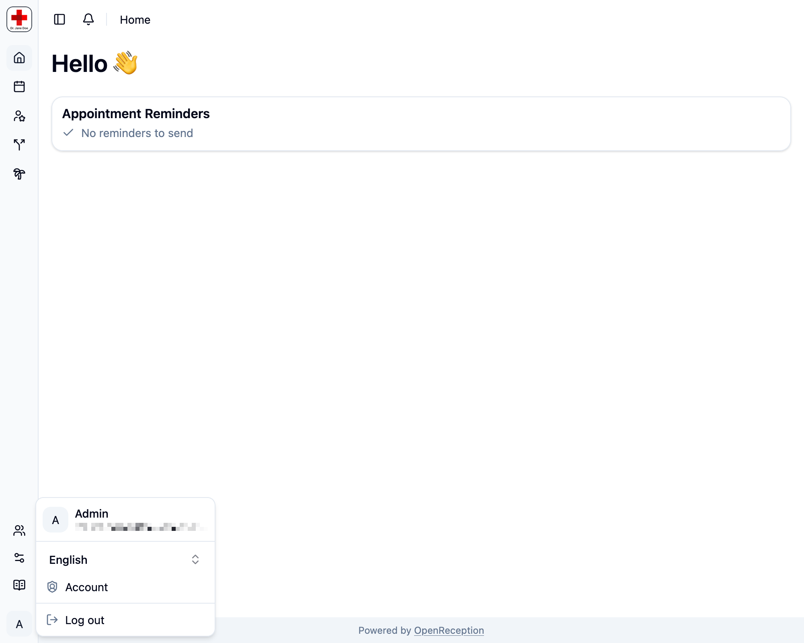
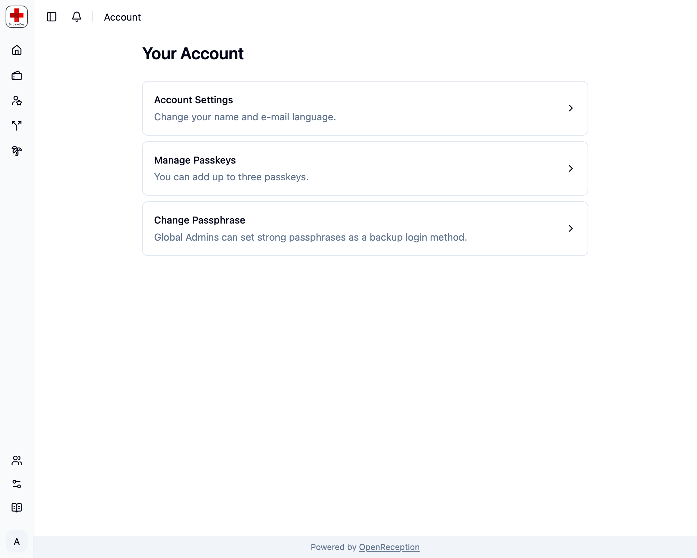
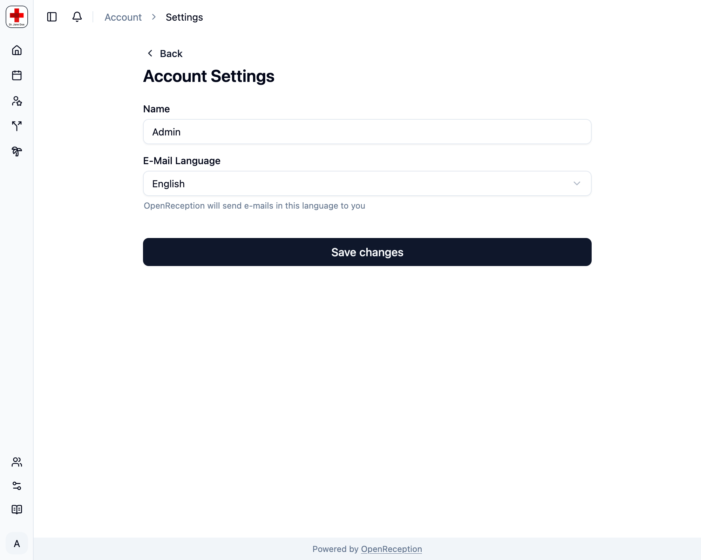

import {LinkCard} from "@astrojs/starlight/components";
import {CardGrid} from "@astrojs/starlight/components";

Go to the account settings using the bottom of the navigation sidebar.

On the account overview page you will be able to select the settings you want to change.

<CardGrid>
  <LinkCard
    title="Account Settings"
    href="#account-settings"
    description="Name and E-Mail language"
  />
  <LinkCard
    title="Manage Passkeys"
    href="/account/manage-passkeys"
    description="Add up to three Passkeys"
  />
  <LinkCard
    title="Change Passphrase"
    href="/account/change-global-admin-passphrase"
    description="Change your current passphrase"
  />
</CardGrid>

## Account Settings

In the account settings, you can update your name and E-Mail language preferences.

