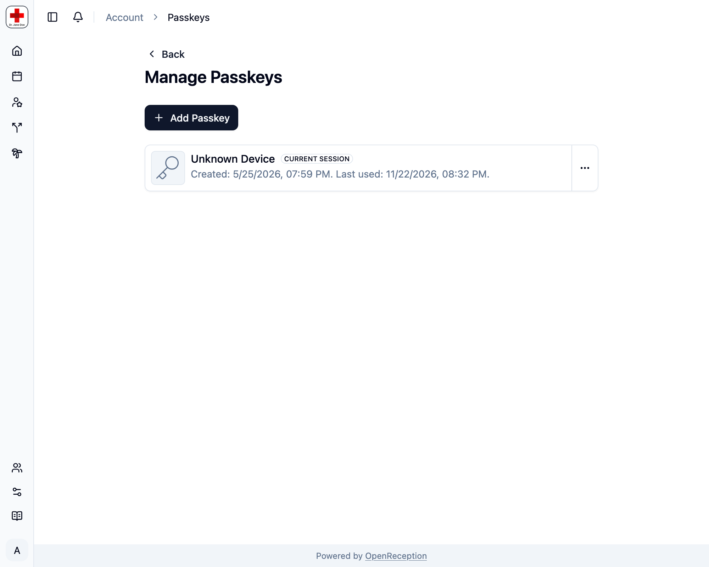
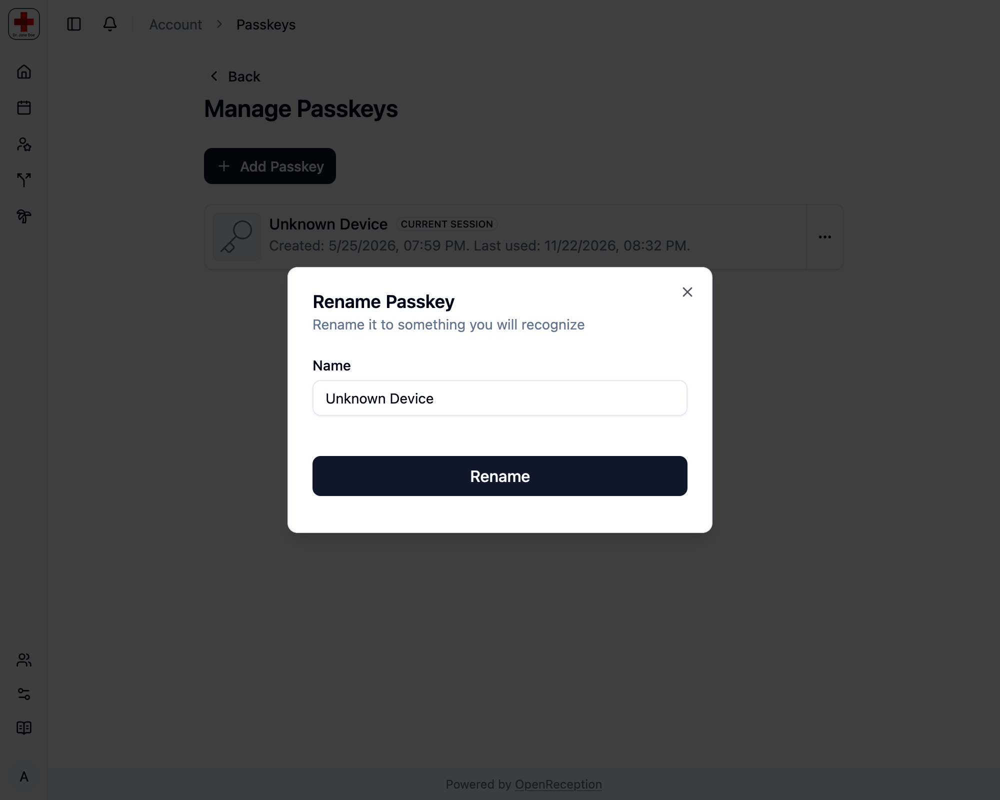
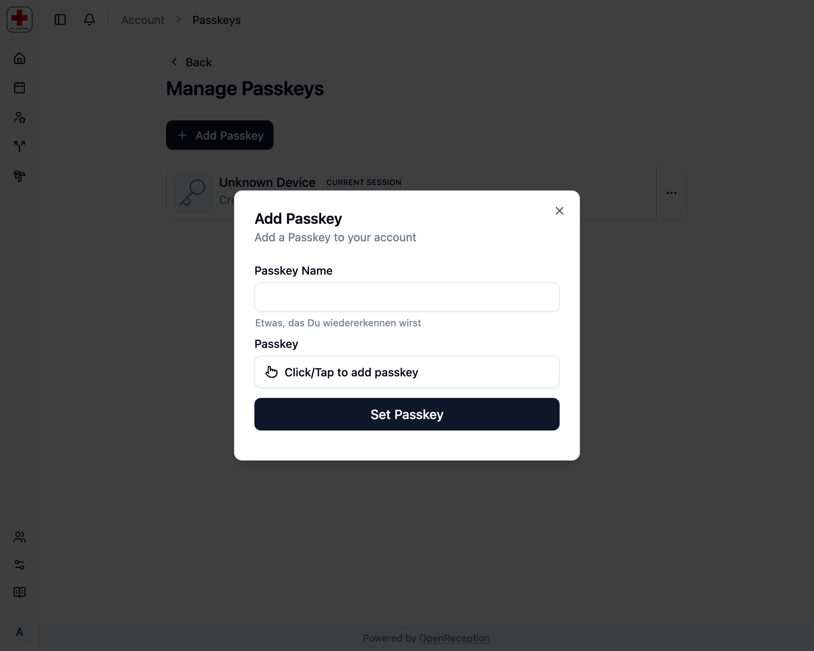

On the _Manage Passkeys_ page, you can add and manage up to three passkeys for your account. For each passkey, you can see:

- a name (change it, if you like)
- the creation date
- the last used date
- if it's used in your current session

## Naming Passkeys

Open the context menu and select _Edit_. You can add a name for each Passkey, so you can recognize them easily later. This is useful if you have multiple Passkeys, which we recommend for Tenant Admins.

## Adding Passkeys

To add a new Passkey, click on the _Add Passkey_ button and follow the instructions. You can add up to three Passkeys for your account.

For additional guidance on adding a Passkey, please [refer to the account setup process](/account/setup-account), which provides step-by-step instructions.

