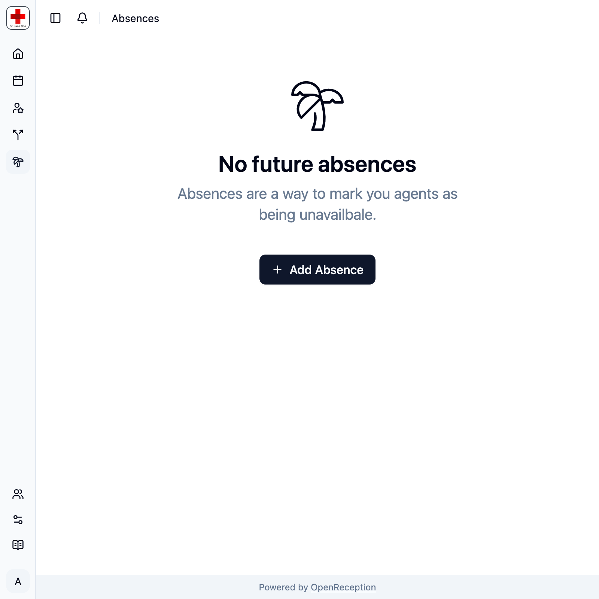
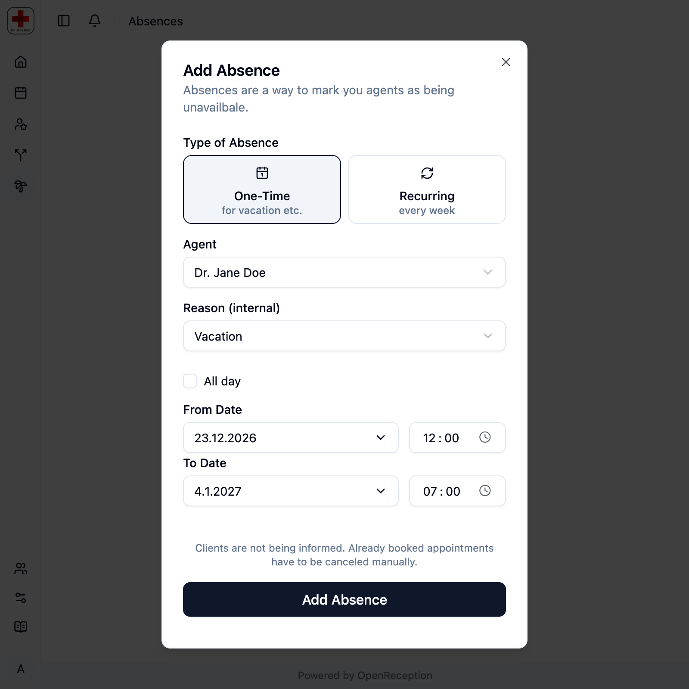
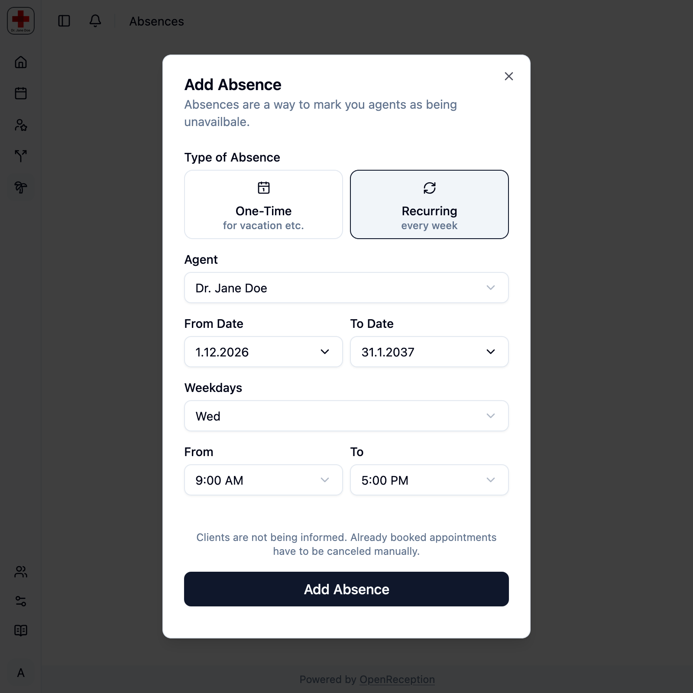
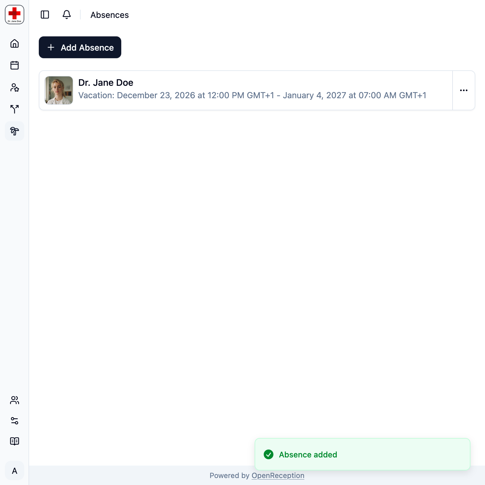
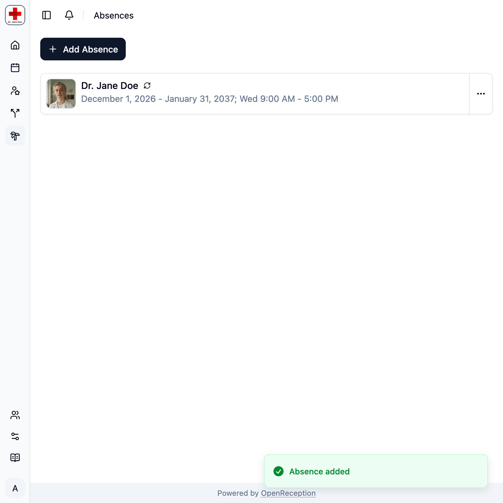

import {Steps} from "@astrojs/starlight/components";

<Steps>

1. Navigate to the absences section of the dashboard and click on _Add Absence_

   

1. A modal with a form opens.
   - Select the absent **type** one-time or recurring
   - Select the absent **agent**
   - Change the **reason**, if you want to track it here.
   - Select a range for the absence. The **to date** must be in the future.

   

   If you've selected a recurring absence, additional options for the recurrence pattern will appear:
   - Select the **weekday/s**
   - Select the **from** and **to** times

   :::tip
   To set this for a long period select a **To Date** far in the future.
   :::

   

1. Click _Add Absence_ and it will be saved.
   

   Recurring absences will have a circular icon indicating their recurrence.

   

</Steps>
