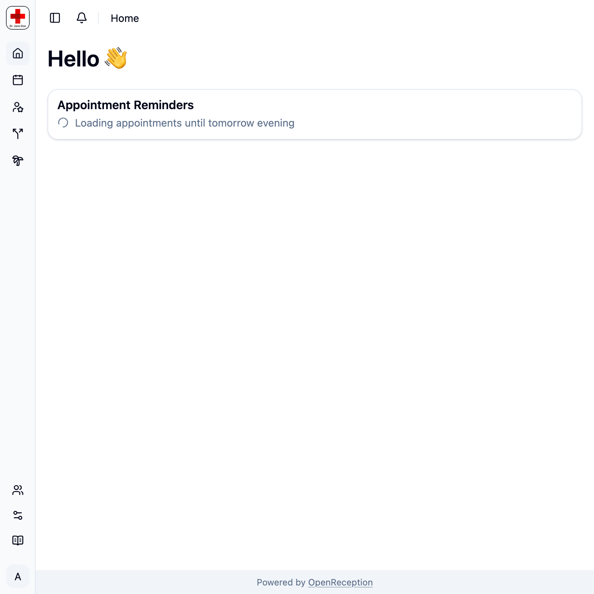

For now OpenReception supports automated reminders for appointments, when opening the dashboard.

## Semi-Automated Reminders

You don't need to set up Semi-Automated Reminders to run. When you login, OpenReception will automatically send reminders for upcoming appointments.

Reminders will be sent for appointments **today and tomorrow**, if they

- are in the future AND
- are not booked today AND
- have a client, who wishes to receive updates AND
- have not been reminded yet.
