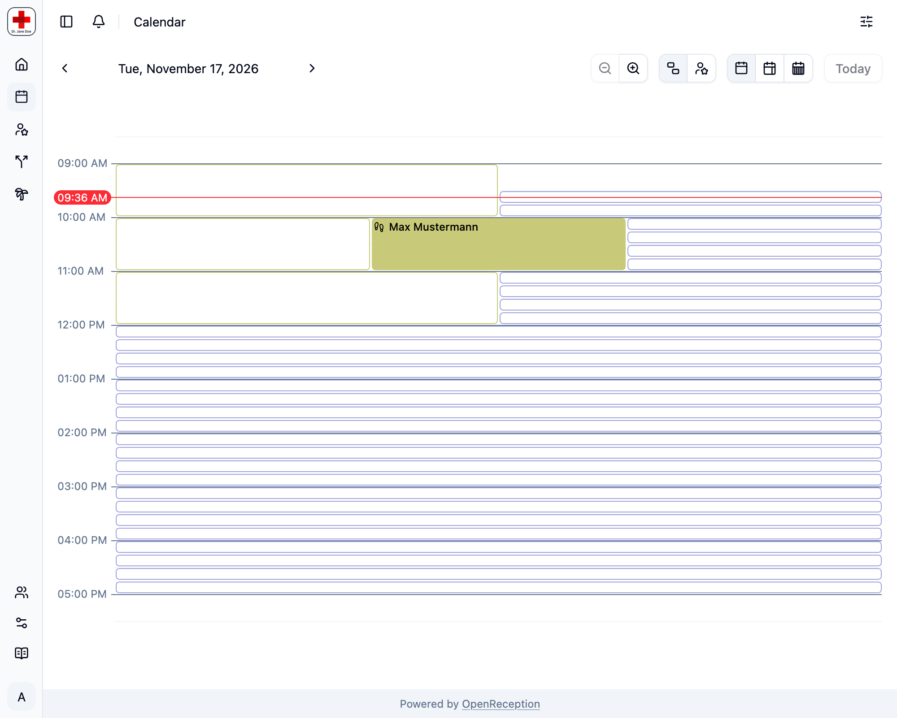
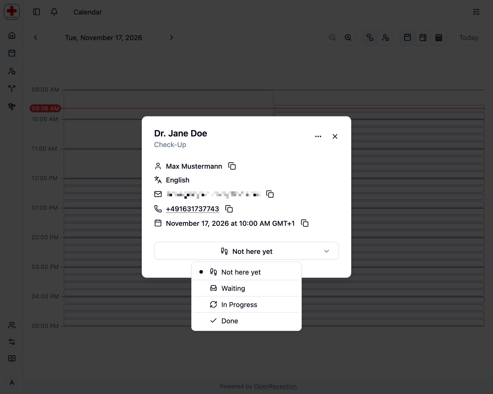
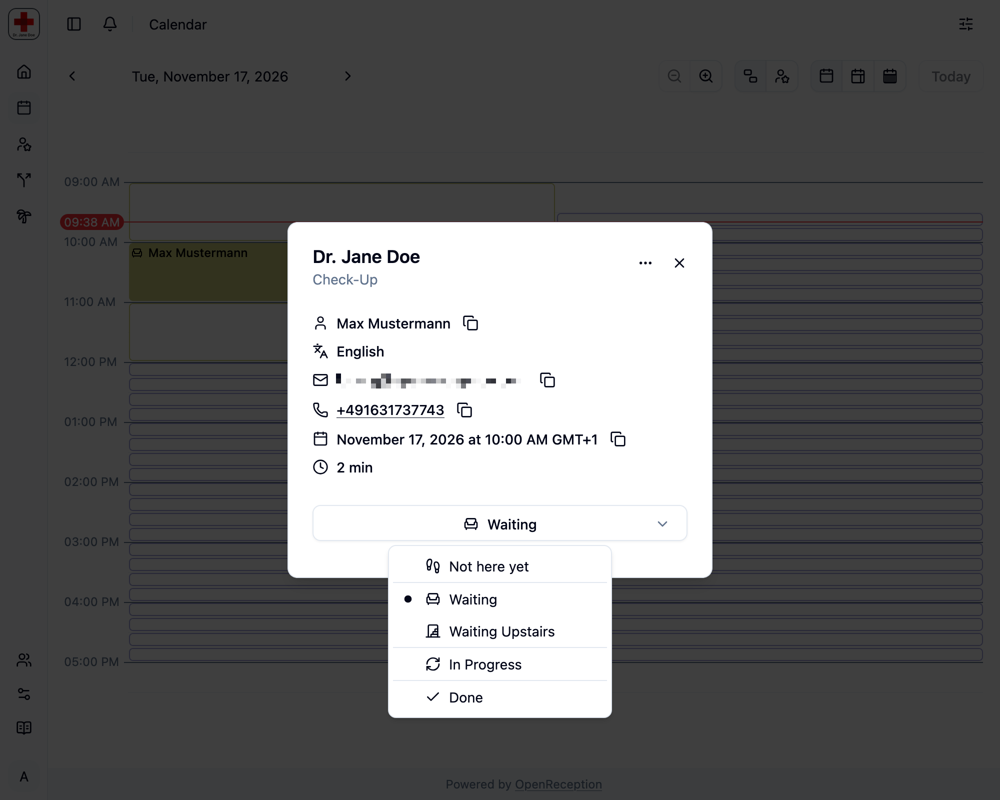
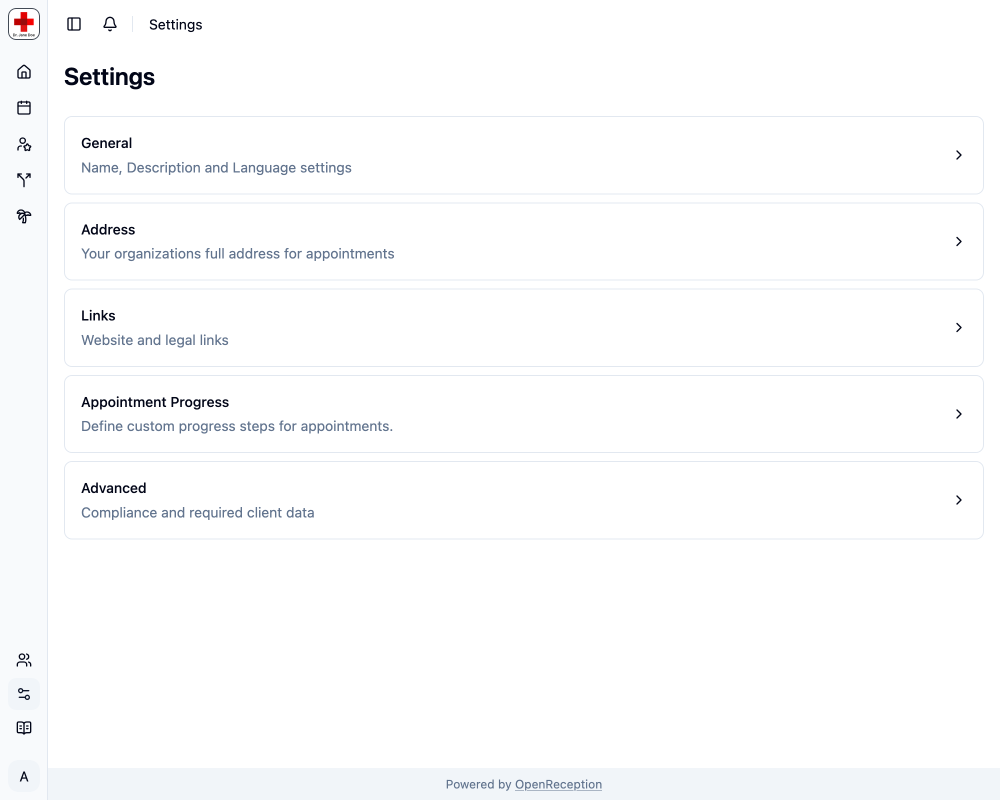
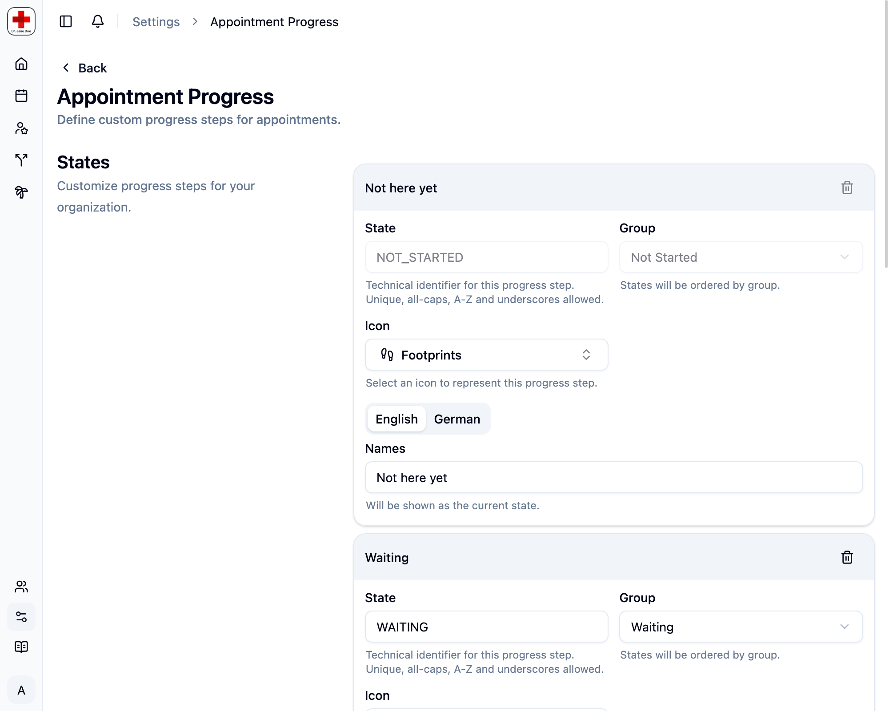
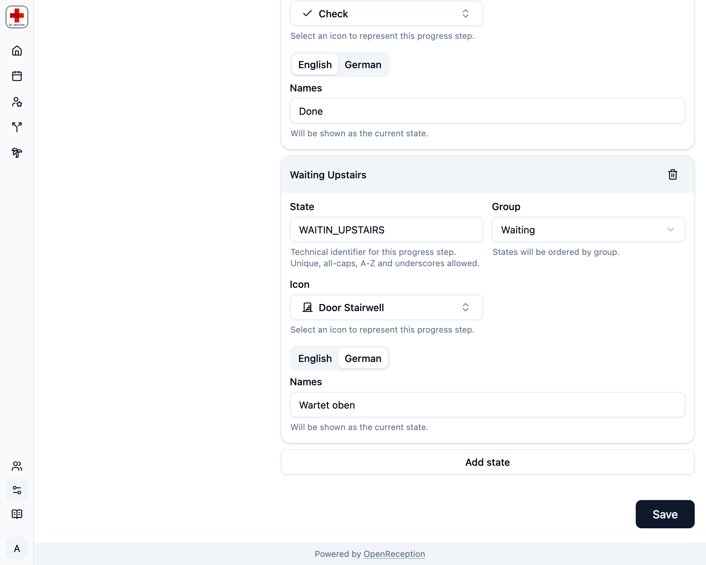
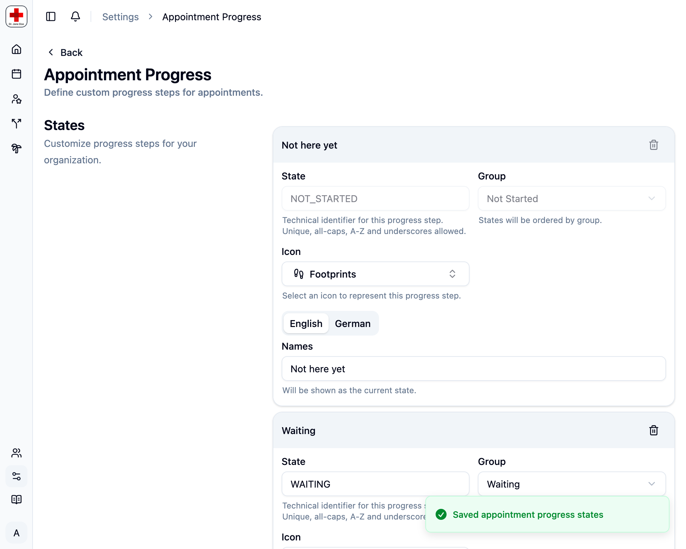
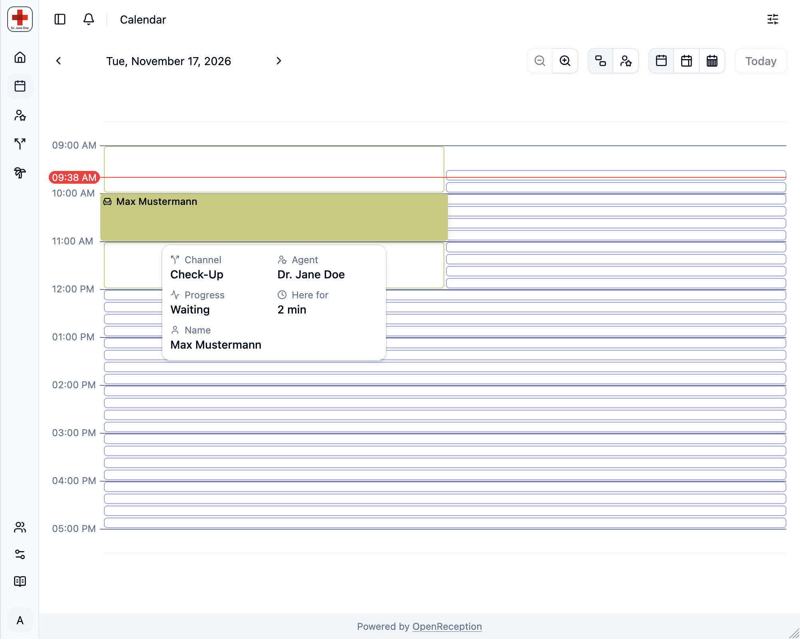

import {Badge} from "@astrojs/starlight/components";
import {Steps} from "@astrojs/starlight/components";

When an appointment takes place today, it will show the appointment progress right in the calendar overview.

A footsteps icon will appear on today's appointment:

Once you click on the appointment you will be able to change the appointment progress. You have the following options:

- Not here yet
- Waiting
- In Progress
- Done

## Custom Progress Steps <Badge text="Premium Feature" variant="danger" />

You can define custom progress steps for your appointments. This allows you to track the progress in a way that fits your workflow.

You can define custom progress steps in the settings area. To manage them

<Steps>

1. Navigate to the settings section of the dashboard and click on _Appointment Progress_.

   

1. In the _Appointment Progress_ settings, you can manage default progress steps and add custom ones.

   

1. At the bottom of the list you can _add a state_. Within a state you can
   - Set the **State**, a unique name for this status
   - Set the **Group**, wich is one of **Not Started**, **Waiting**, **In Progress**, or **Done**
   - Set the **Icon**, which will be displayed for this status in the calendar overview
   - Set the **Names**, which will be displayed for this status in the calendar overview; set them for each language you support

   

1. Click _Save_ to apply your changes.

   

</Steps>

## Waiting Time <Badge text="Premium Feature" variant="danger" />

Additionally the waiting will be shown in the calendar, either

- once you hover with the mouse over the appointment in the calendar <Badge text="Plus Feature" variant="danger" />
- or in the appointment details modal.

The waiting time will automatically start once the appointment progress is changed for the first time.

