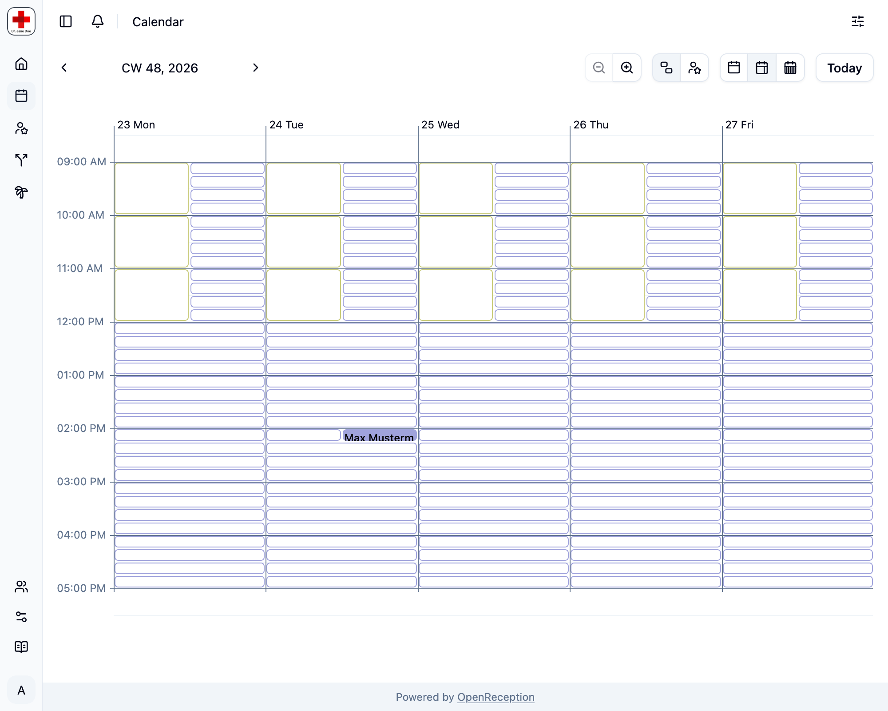
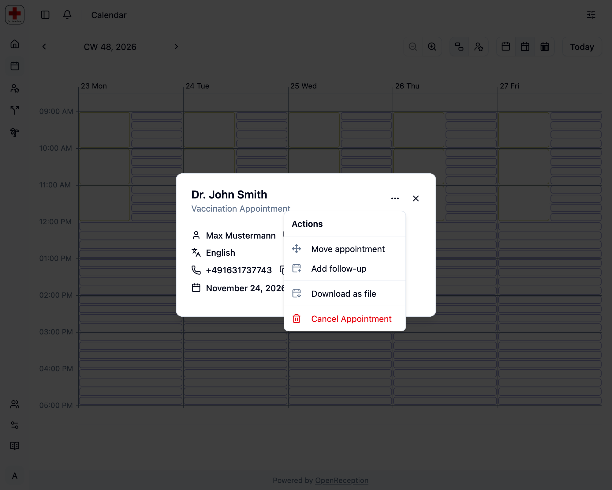
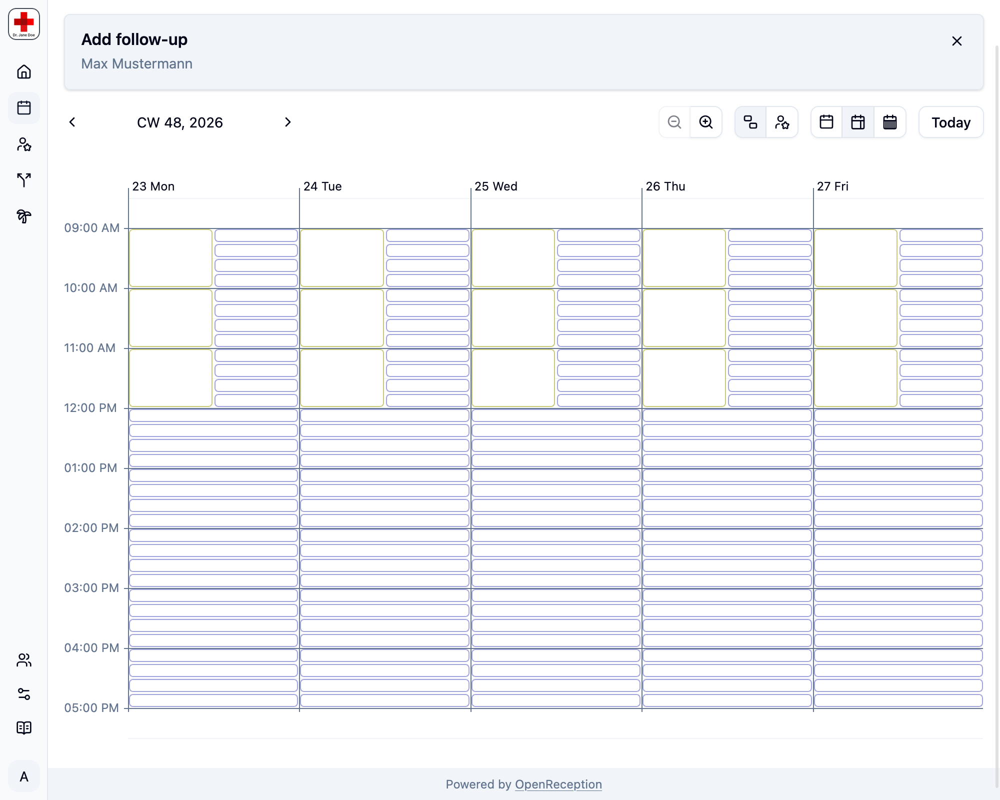
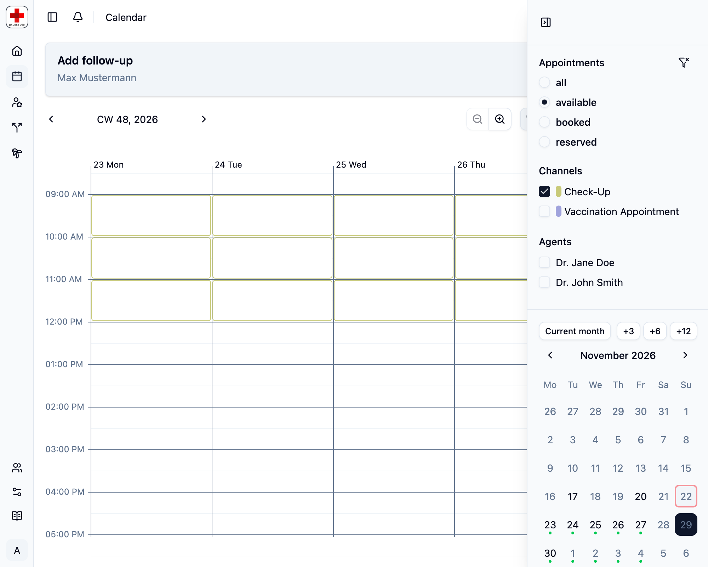
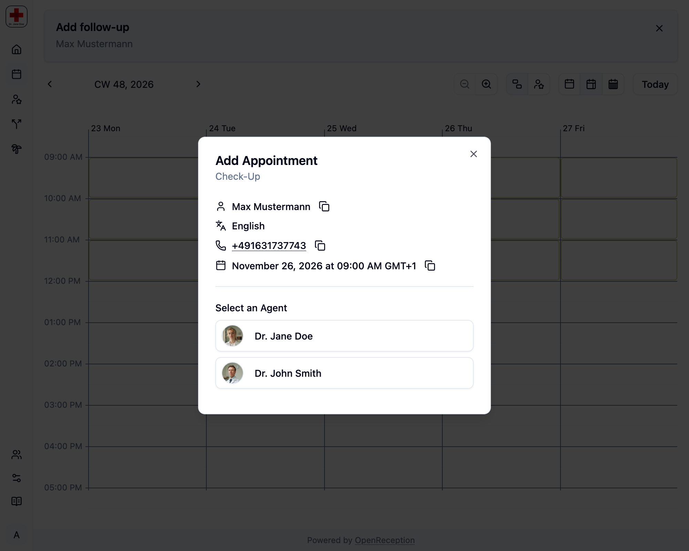
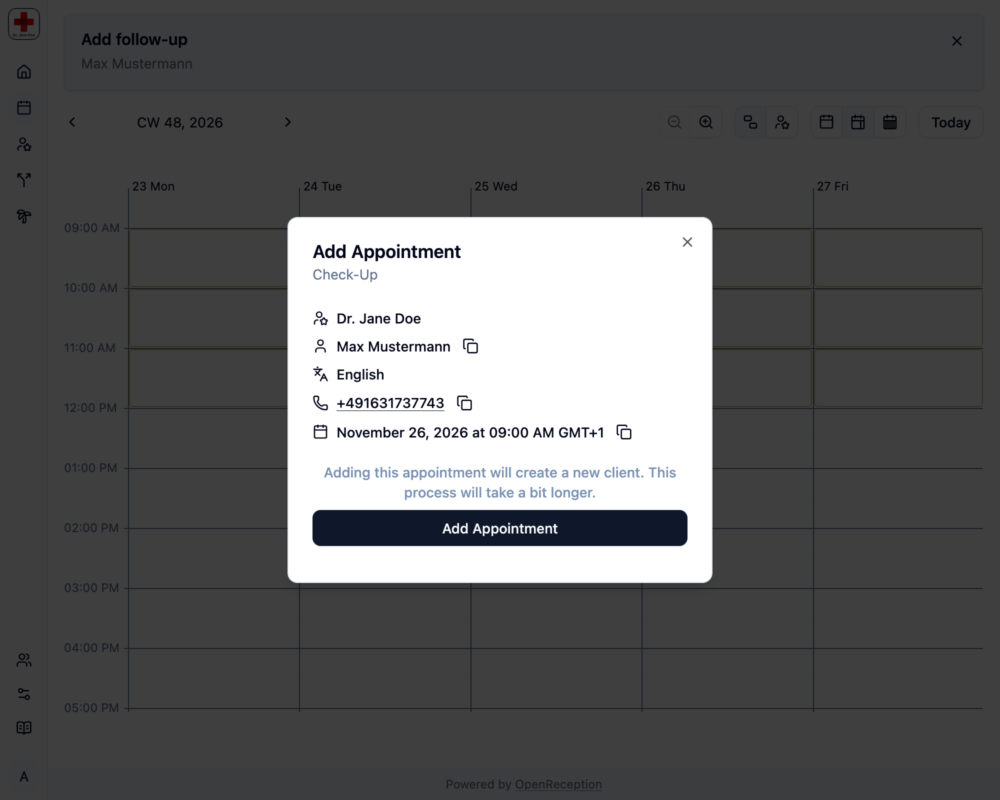
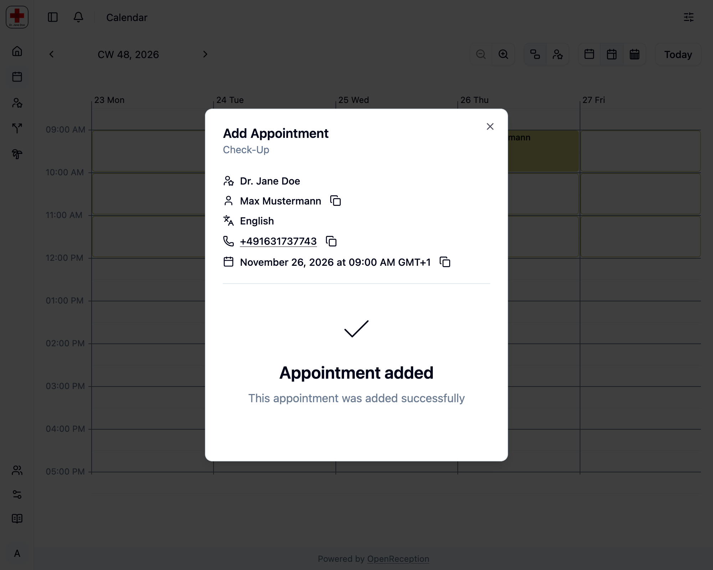
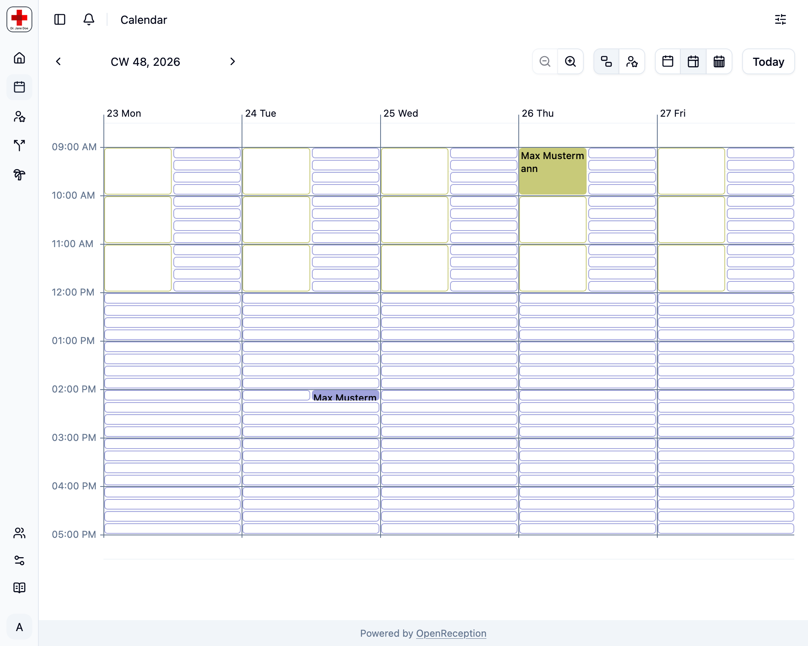

import {Steps} from "@astrojs/starlight/components";
import {Badge} from "@astrojs/starlight/components";

You can add a follow-up appointment from the appointment details modal. We've designed this process to be quick, intuitive, and accessible.

Take the following steps to add a follow-up appointment:

<Steps>
1. Navigate to the calendar section of the dashboard, go to the appointment
  you wish to add a follow-up for and click on it.

    

1. The appointment details modal will open. Open the context menu in the top right corner (three dots). Click _Add Follow-Up_.

   

1. The calendar will go into _add follow-up_ mode, allowing you to select a time slot for the follow-up appointment. You can recognize being in a mode when a highlighted box is shown above the calendar.
   - Cancel the operation anytime by clicking the _X_ icon in the top right corner.
   - Use the calendar like you normally would to add a follow-up appointment.

   

1. If you want to filter available time slots by agent or other criteria, open the filters panel.

   

1. If multiple agents are available, select the agent you prefer.

   

1. Confirm the follow-up appointment.

   

1. The appointment is now added. If the client had enabled notifications in the previous appointment, they will also be informed. The modal stays open for you to tell the client the new date and time, if they wish.

   

1. When you close the modal, you will see the new appointment in the calendar.

   

</Steps>
