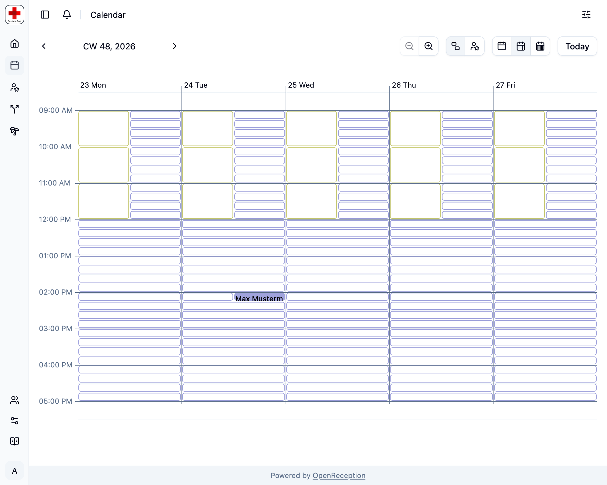
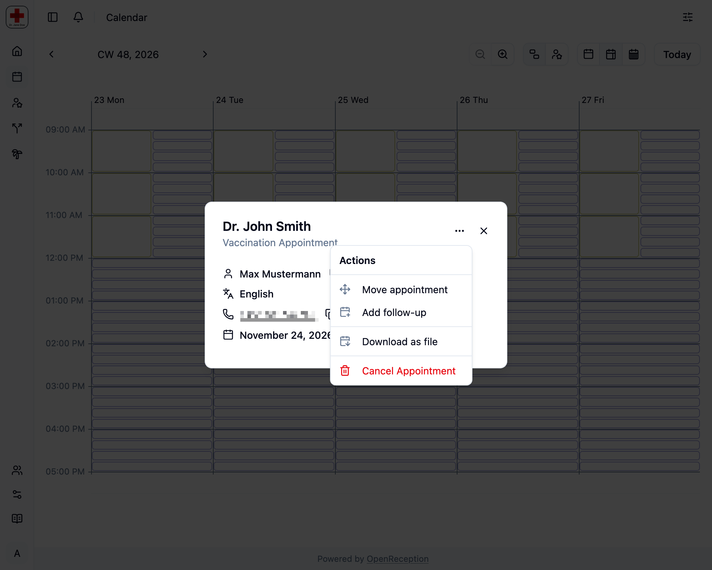
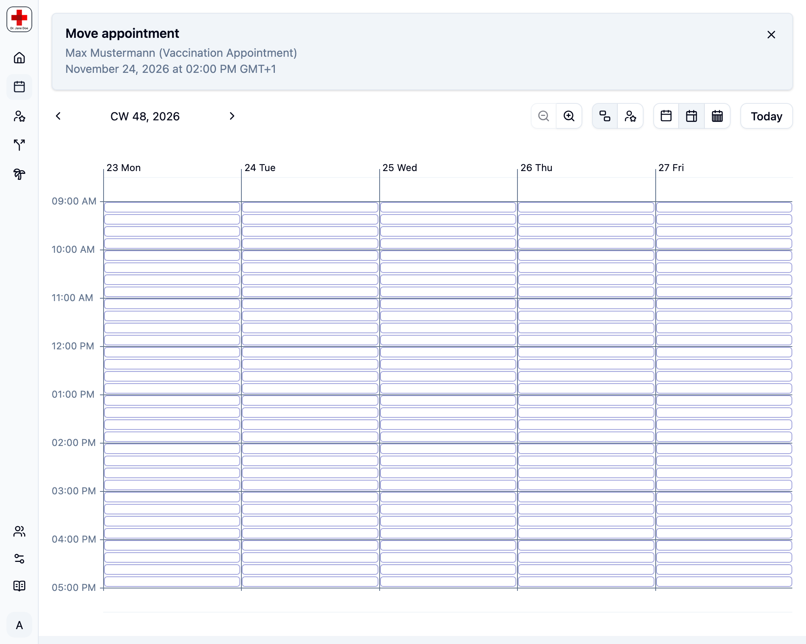
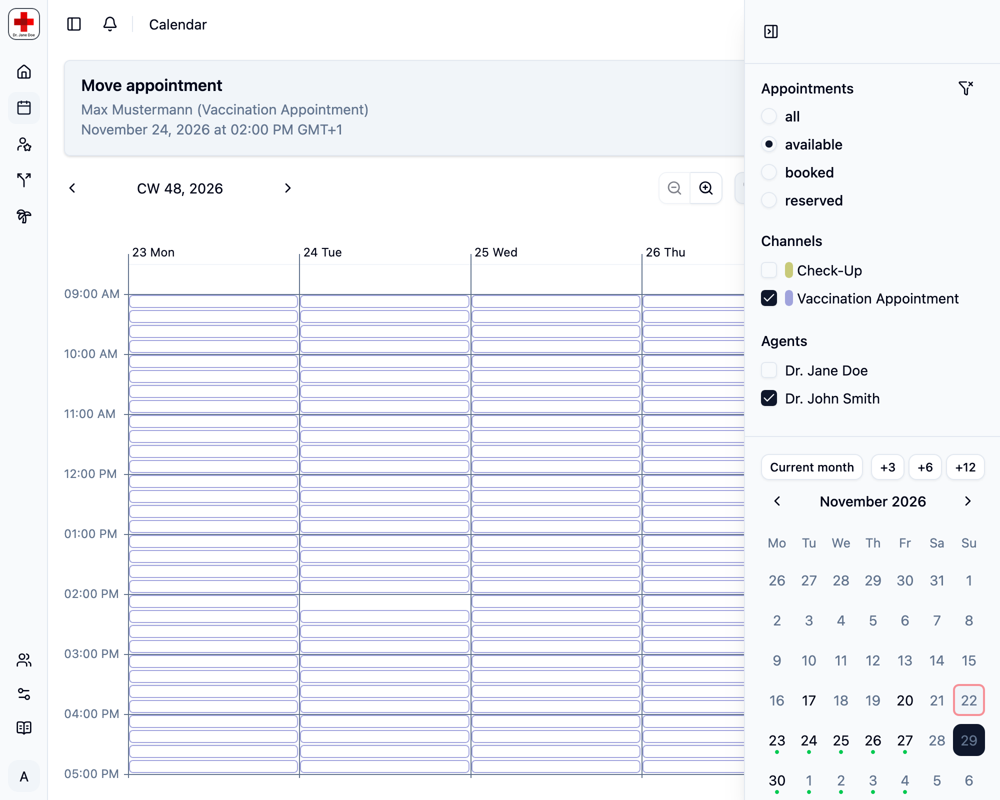
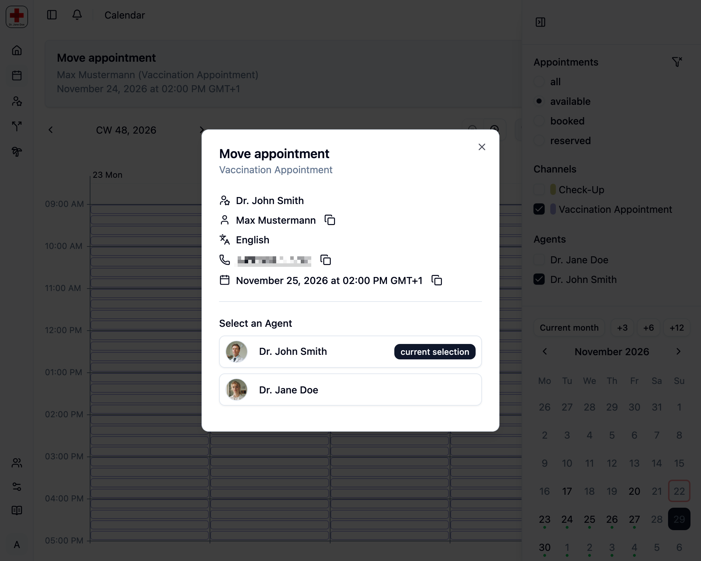
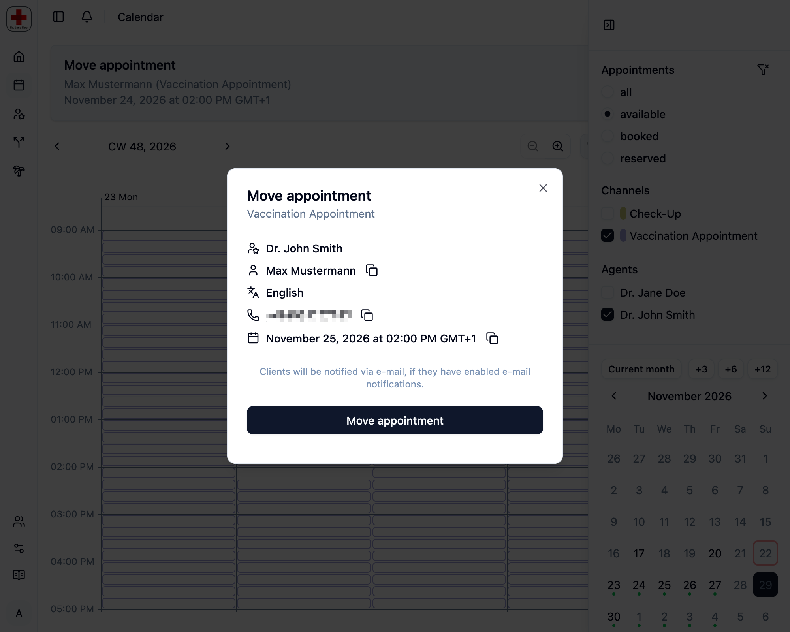
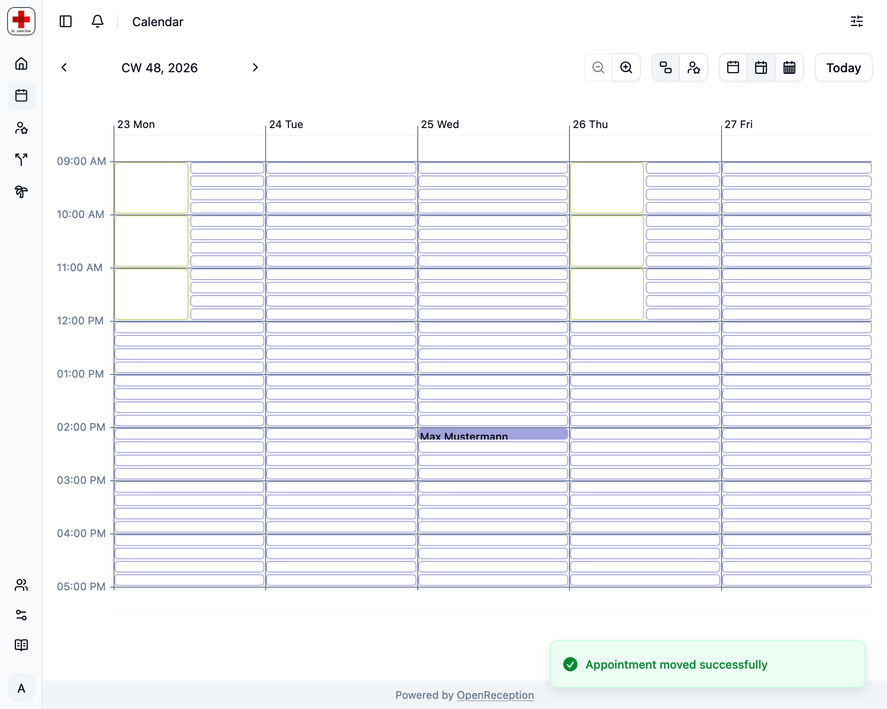

import {Steps} from "@astrojs/starlight/components";
import {Badge} from "@astrojs/starlight/components";

You can change the date and time of an appointment from the appointment details modal. We've designed this process to be quick, intuitive, and accessible.

When moving an appointment you are able to place it in a slot and see agent availability at the same time.

Take the following steps to move an appointment:

<Steps>
1. Navigate to the calendar section of the dashboard, go to the appointment
  you wish to move and click on it.

    

1. The appointment details modal will open, showing the current date and time of the appointment. Open the context menu in the top right corner (three dots). Click _Move Appointment_.

   

1. The calendar will go into _move_ mode, allowing you to select a new time slot for the appointment. You can recognize being in a mode when a highlighted box is shown above the calendar.
   - Cancel the operation anytime by clicking the _X_ icon in the top right corner.
   - Use the calendar like you normally would to select a new time slot for the appointment.

   

1. If you want to filter available time slots by agent or other criteria, open the filters panel.

   

1. You may change the agent right here. <Badge text="Premium Feature" variant="danger" />

   

1. Confirm the new time slot.

   

1. The appointment will be moved to the new time slot and a notification will be shown. If the client has enabled notifications, they will also be informed about the change.

   

</Steps>
