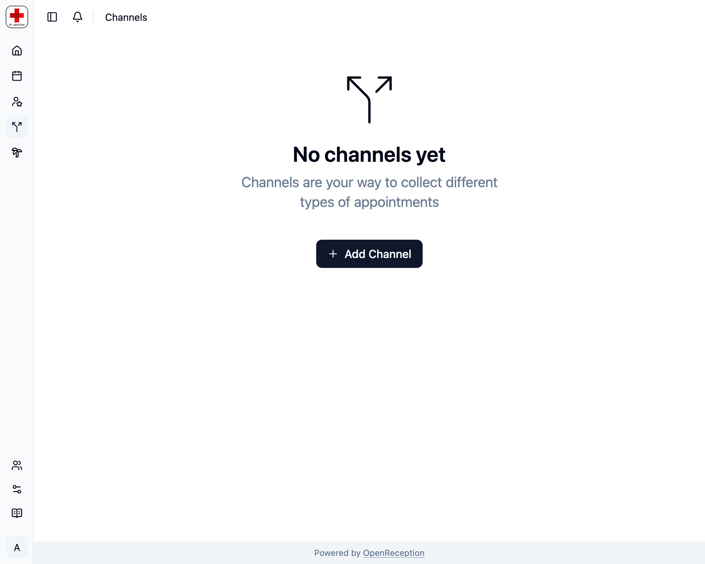
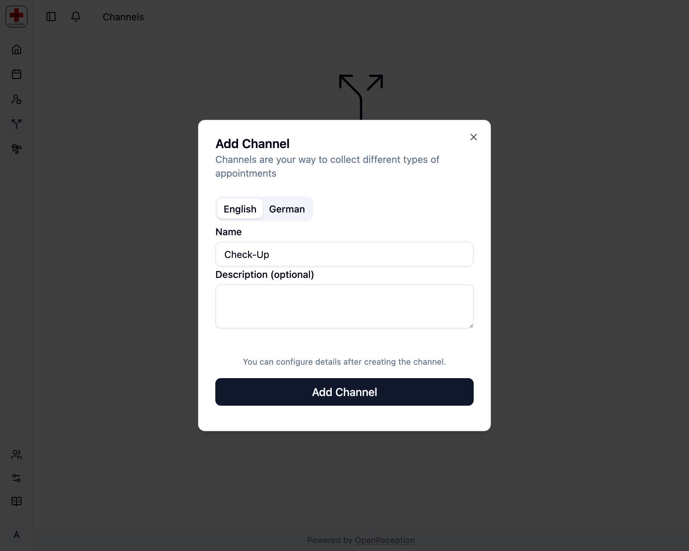
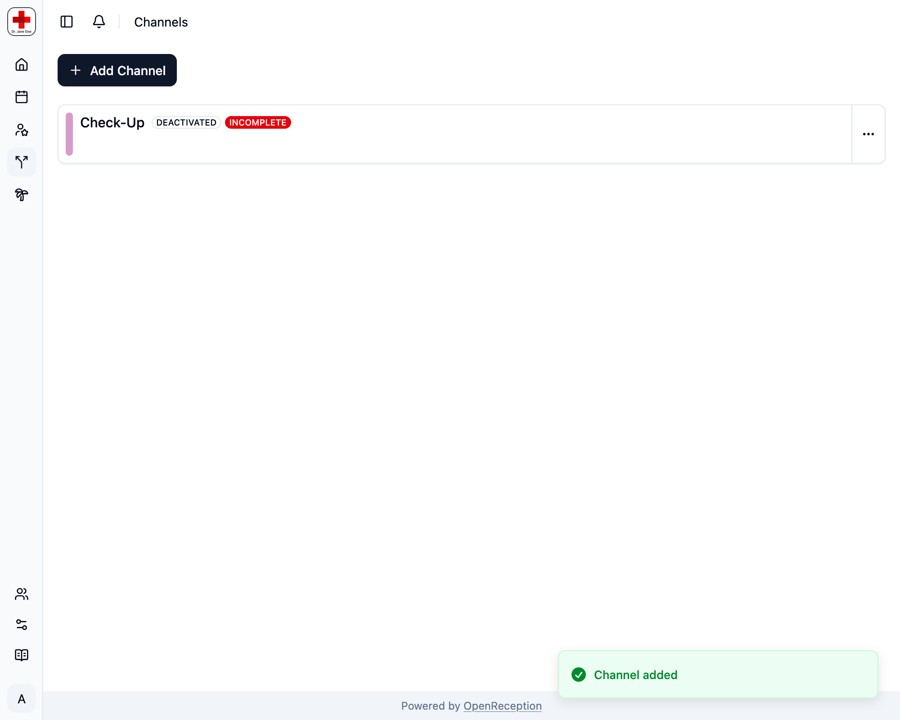

import {Steps} from "@astrojs/starlight/components";

:::note
Before you add a channel, make sure you've [set up all the tenant languages](../../settings/base-settings).
:::

<Steps>

1. Navigate to the channels section of the dashboard and click on _Add Channel_

   

1. A modal with a form opens. Add a **name** and **description** in all your languages.

   

1. Then click _Add Channel_ and it will be saved.

   

</Steps>

You've successfully added a new channel. It will not be shown publicly until you've added agents, a schedule and enabled it. [Edit a channel](/channels/edit-channel) to make these changes.
