import {Steps} from "@astrojs/starlight/components";
import {Badge} from "@astrojs/starlight/components";

:::note
If you use descriptions and have added languages since the last time you've edited a channel, you can only save your changes, if you add descriptions of all missing languages.
:::

<Steps>

1. Navigate to the channels section of the dashboard, search for the channel you want to edit and open the context menu for it. Click on _Edit_.

   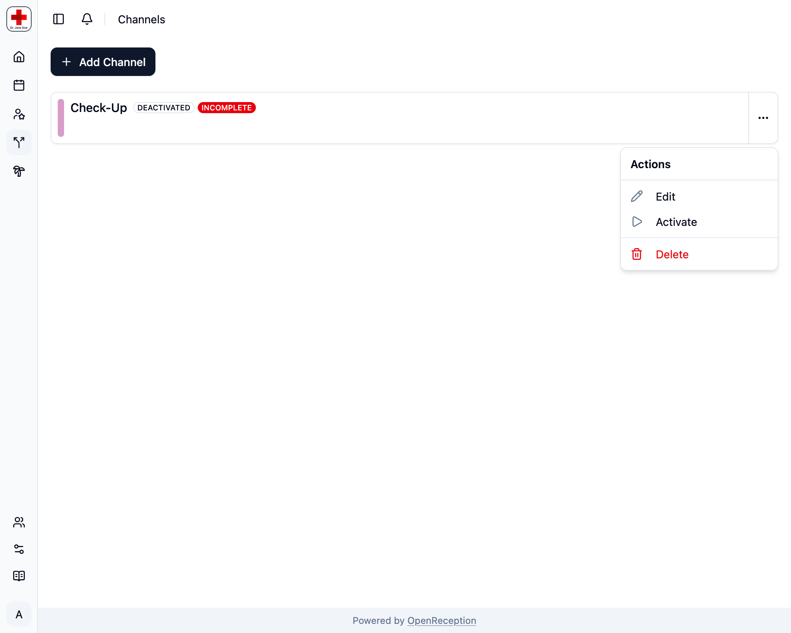

1. If you channel is not fully set up, each required step will have a red indicator.

   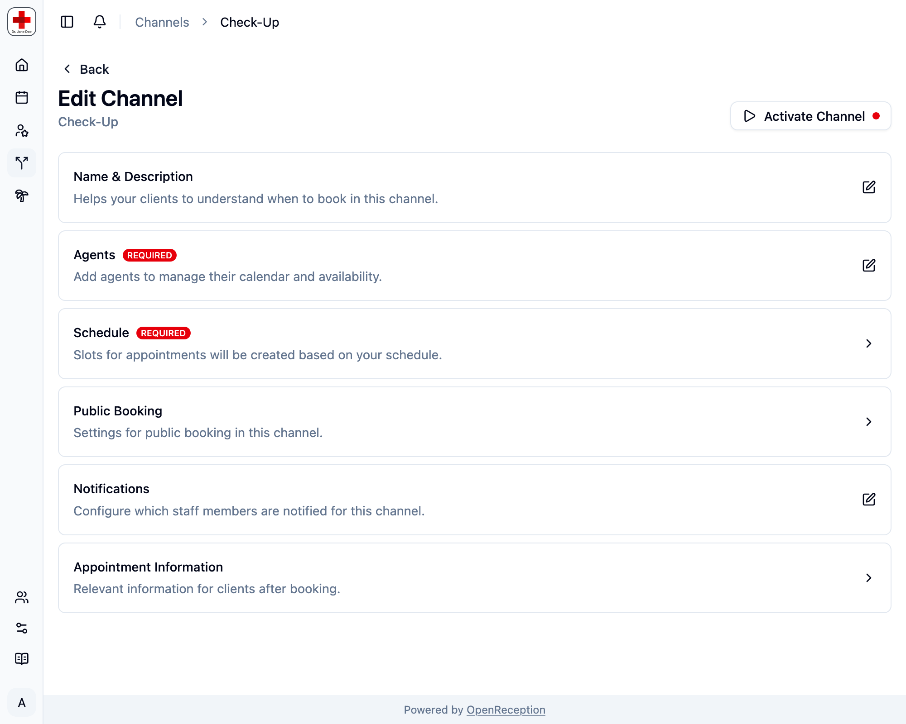

1. Click on each section you want to edit and make your changes.

</Steps>

## Name & Description

Click on the _Name & Description_ section to edit the channel's name and description.

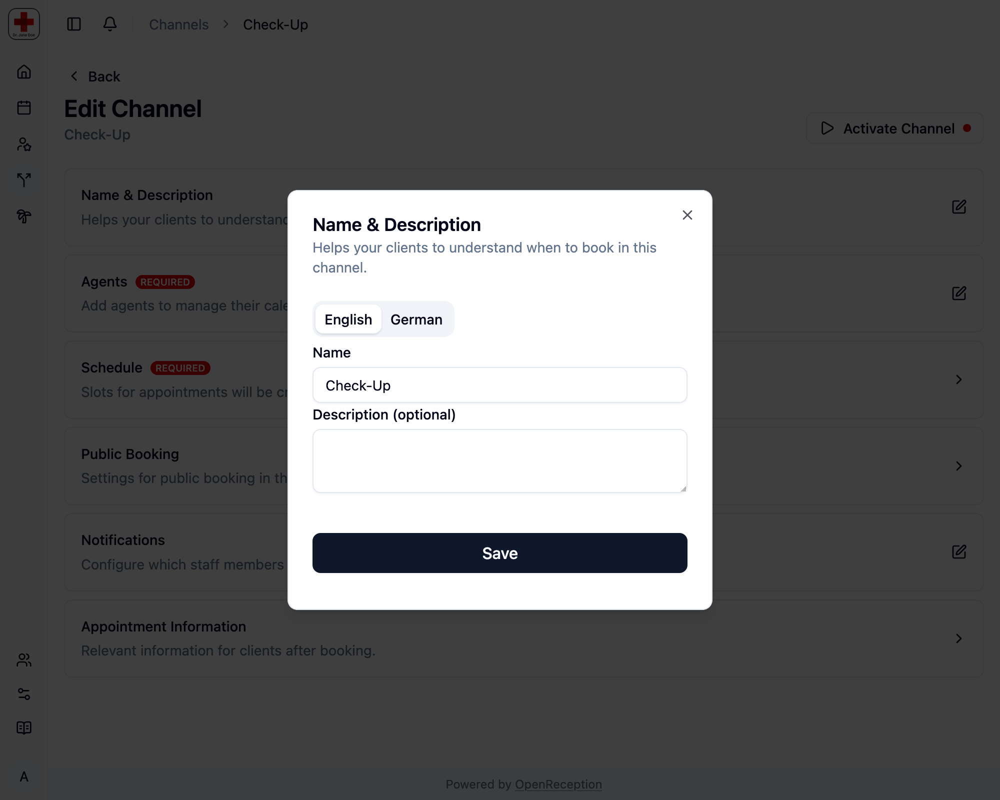

## Agents

Click on the _Agents_ section to edit the agents that can conduct appointments in this channel. When clients are auto-selecting agents they will be selected in the order you've set in this list.

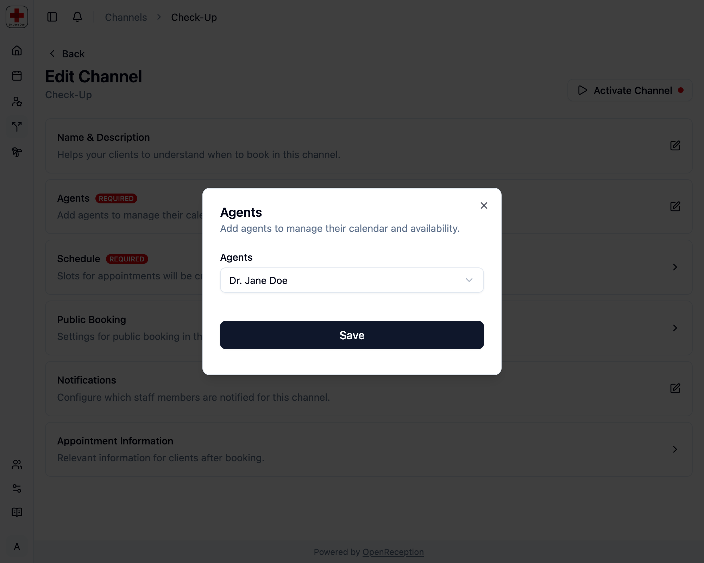

## Schedule

Click on the _Schedule_ section to edit the schedule for this channel. You can add as many schedule templates as needed. For each template you can set

- Weekdays
- Start time
- End time
- Duration

Slots for appointments will be automatically created based on the schedule templates you have defined.

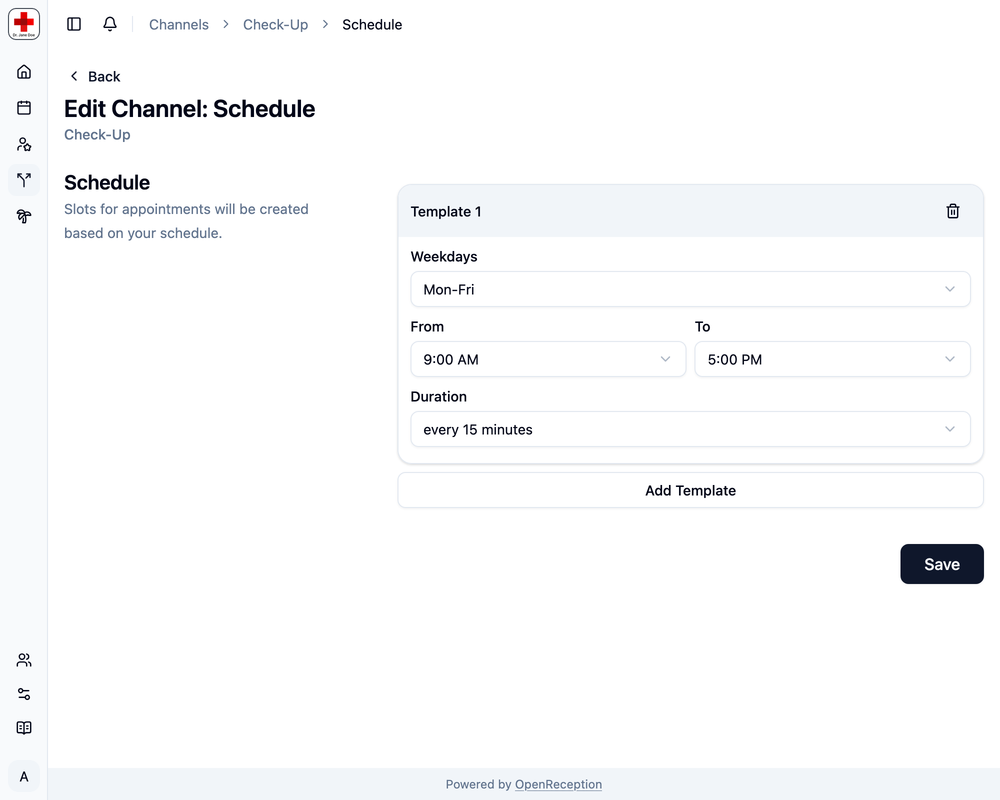

## Public Booking

This section allows you to configure how clients that use public booking can interact with this channel.

- Change if this channel should be **public**. If It's not public, only you can book an appointment using the [calendar](/calendar).
- Change if appointments **require confirmation**. You will be [notified by the notification system](/staff/notifications) if a new request is added.
- Add [deadlines](#deadlines) for client interaction.

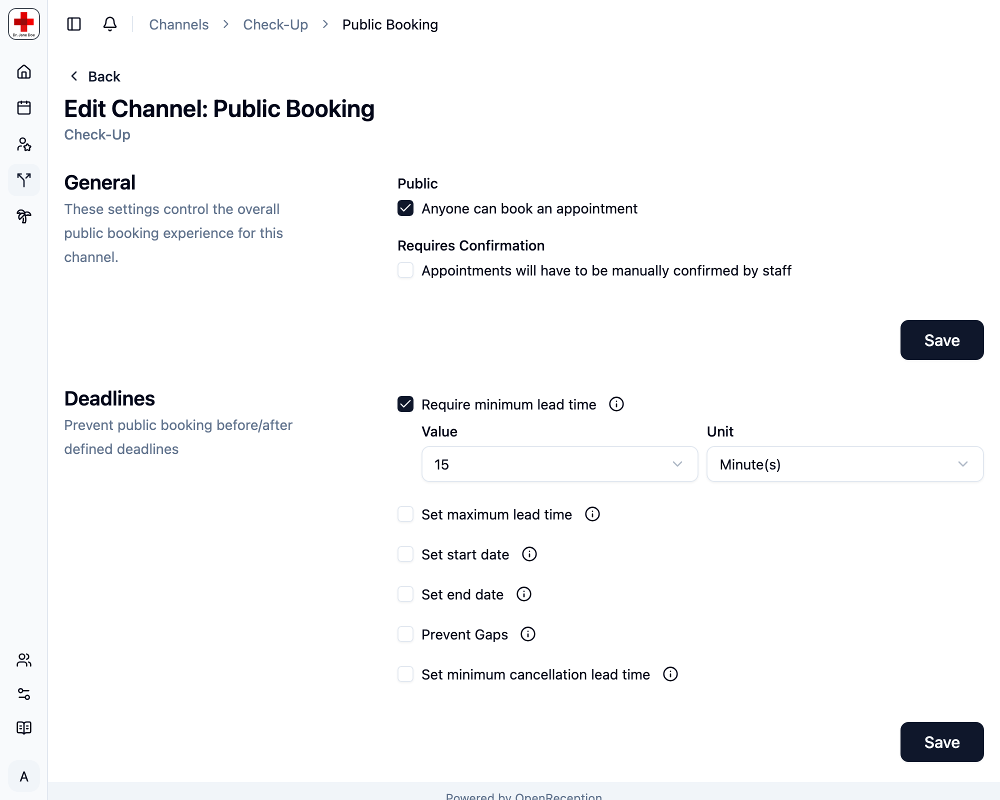

### Deadlines

Define when certain actions are allowed. You can define the following deadlines:

- **Require minimum lead time for booking appointments:** Minimum time an appointment has to be booked in advance
- **Require maximum lead time for booking appointments:** Maximum time an appointment can be booked in advance
- <Badge text="Premium-Feature" variant="danger" /> **Set start date:** Absolute
  date and time from which appointments can be booked.
- <Badge text="Premium-Feature" variant="danger" /> **Set end date:** Absolute
  date and time until which appointments can be booked.
- <Badge text="Premium-Feature" variant="danger" /> **Prevent Gaps:** Only
  allows appointments to be booked at the beginning of the channel slot window
  or after existing appointments; 5min tolerance; across all appointments.
- <Badge text="Premium-Feature" variant="danger" /> **Set minimum cancellation
  lead time:** Minimum lead time to cancel an appointment online.

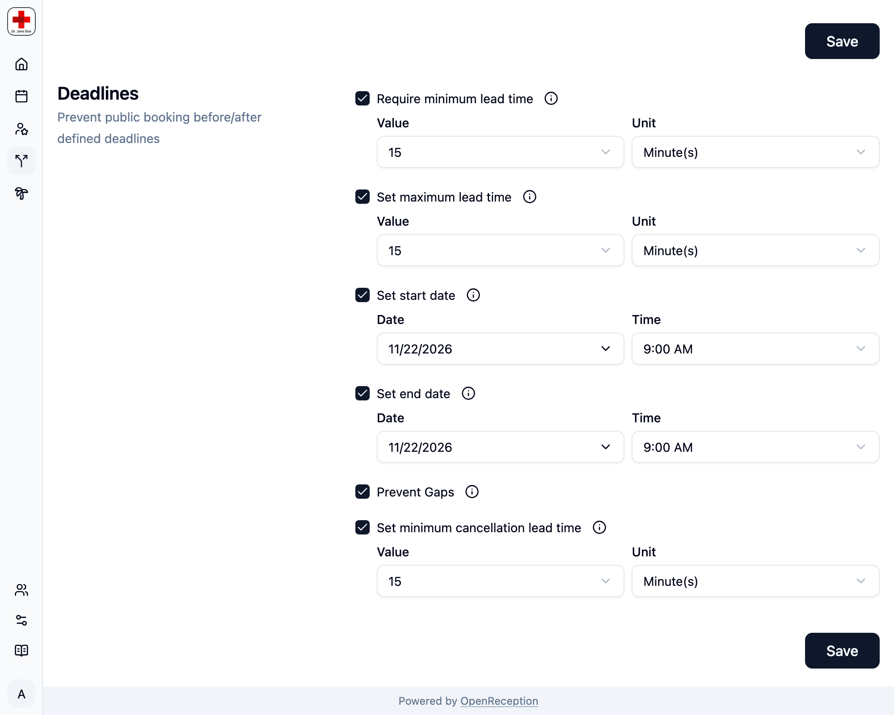

## Notifications

Define which staff members should receive notifications for this channel. Refer to the [notifications documentation](/staff/notifications) for more details.

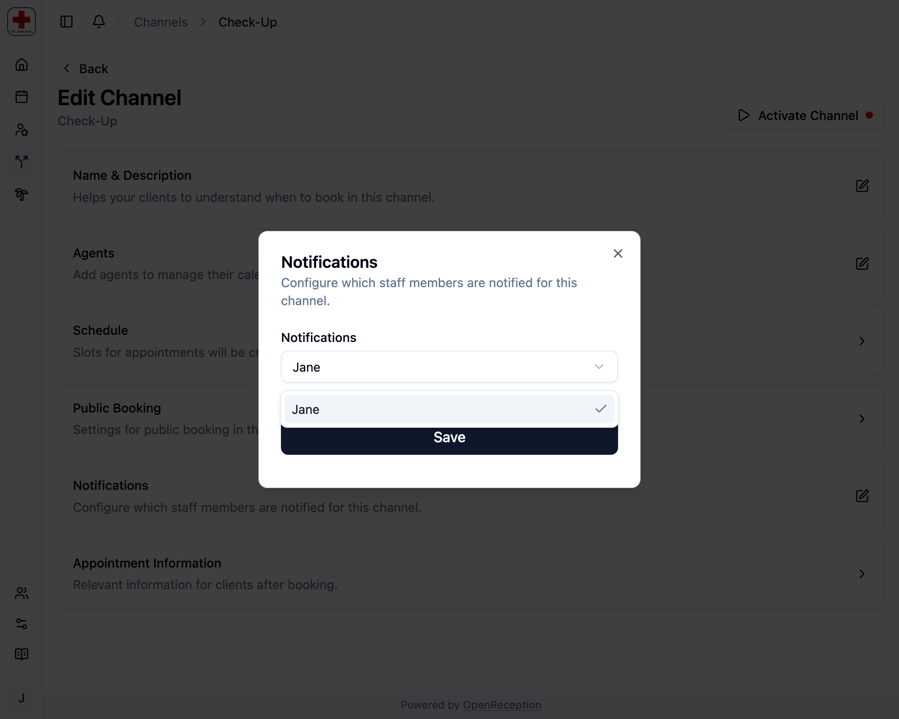

## Appointment Information <Badge text="Plus-Feature" variant="danger" />

Appointment information are client-facing details that clients will see after booking an appointment. You can define the following information:

- **Text:** Use this to provide additional information or instructions to clients regarding their appointment.
- **Links:** Use this to provide relevant links to clients regarding their appointment like online anamnesis forms.
- **Video Room:** Provide a link to a video conferencing room for the appointment. This will be the same link for all appointments in this channel.

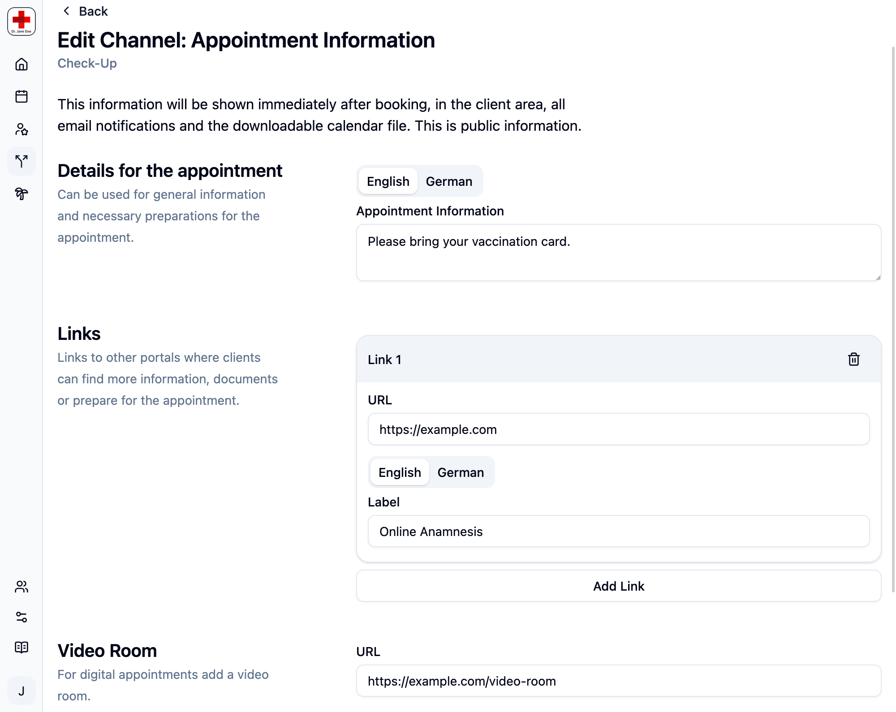

This information will be displayed at a variety of touchpoints in the client booking experience:

- Right after booking on the confirmation page
- In the appointment details on the client dashboard
- In the appointment request E-Mail
- In the appointment confirmation E-Mail
- In the booking reminder E-Mails
- In all calendar files (via download or E-Mail attachment)

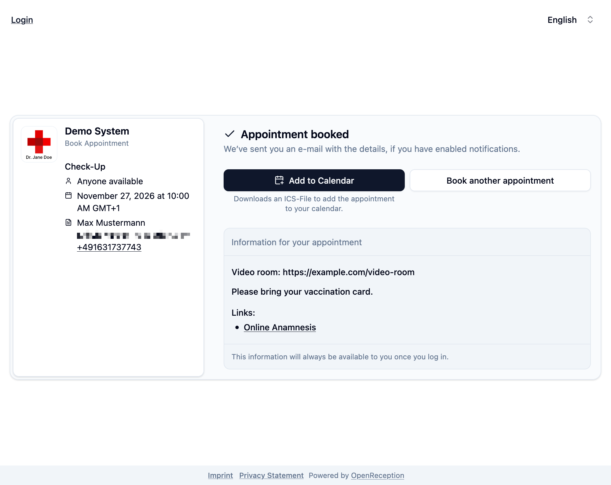

## Activate/ Deactivate Channel

You can activate or deactivate this channel using button in the top right corner. When a channel is deactivated, it will not be available for booking.

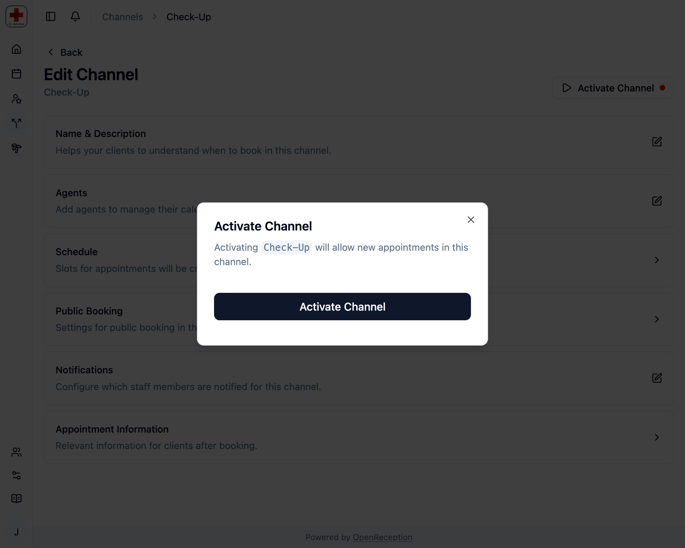
