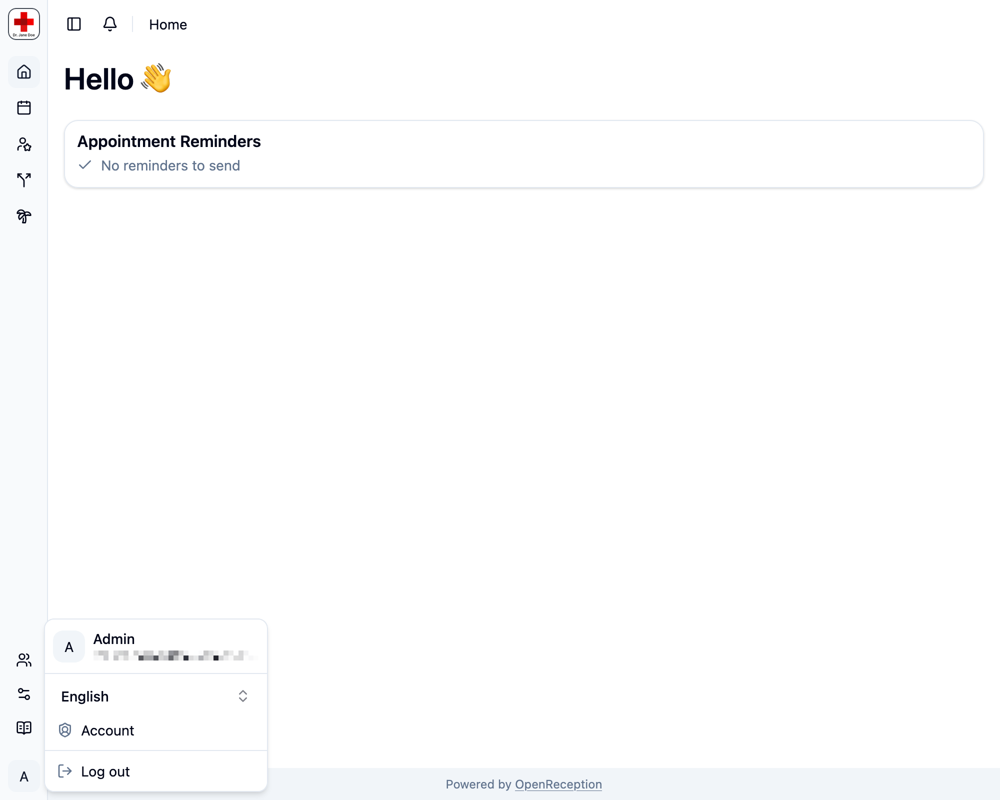
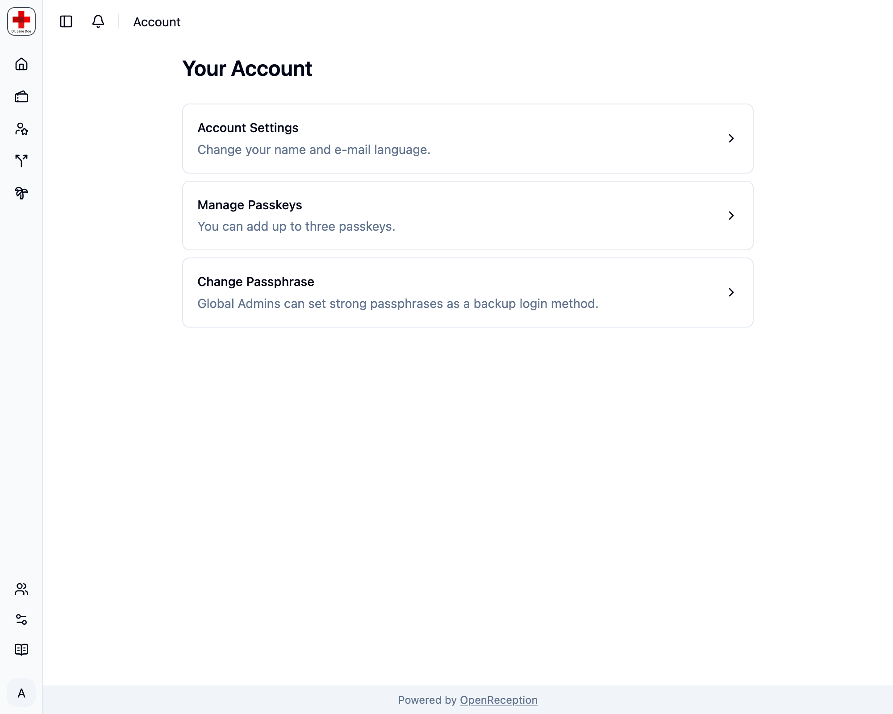
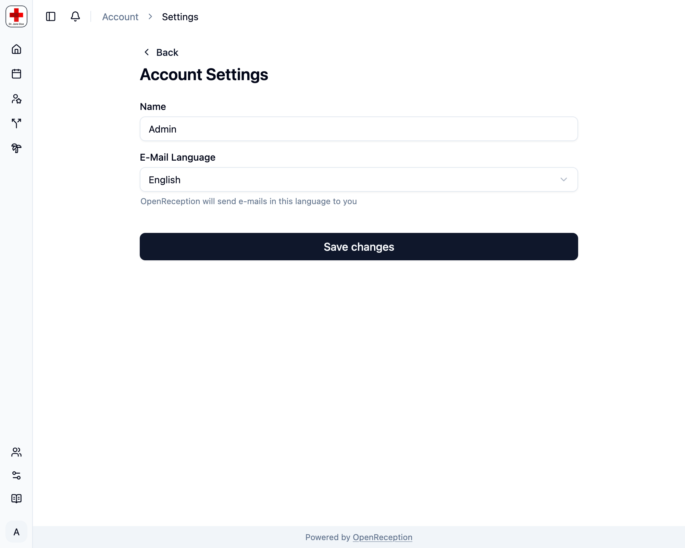

import {LinkCard} from "@astrojs/starlight/components";
import {CardGrid} from "@astrojs/starlight/components";

Gehe zu den Kontoeinstellungen über den unteren Bereich der Navigationsleiste.

Auf der Kontoübersichtsseite kannst du die Einstellungen auswählen, die du ändern möchtest.

<CardGrid>
  <LinkCard
    title="Kontoeinstellungen"
    href="#kontoeinstellungen"
    description="Name und E-Mail-Sprache"
  />
  <LinkCard
    title="Passkeys verwalten"
    href="/de/account/manage-passkeys"
    description="Füge bis zu drei Passkeys hinzu"
  />
  <LinkCard
    title="Passphrase ändern"
    href="/de/account/change-global-admin-passphrase"
    description="Ändere deine aktuelle Passphrase"
  />
</CardGrid>

## Kontoeinstellungen

In den Kontoeinstellungen kannst du deinen Namen und deine E-Mail-Sprachpräferenzen aktualisieren.

