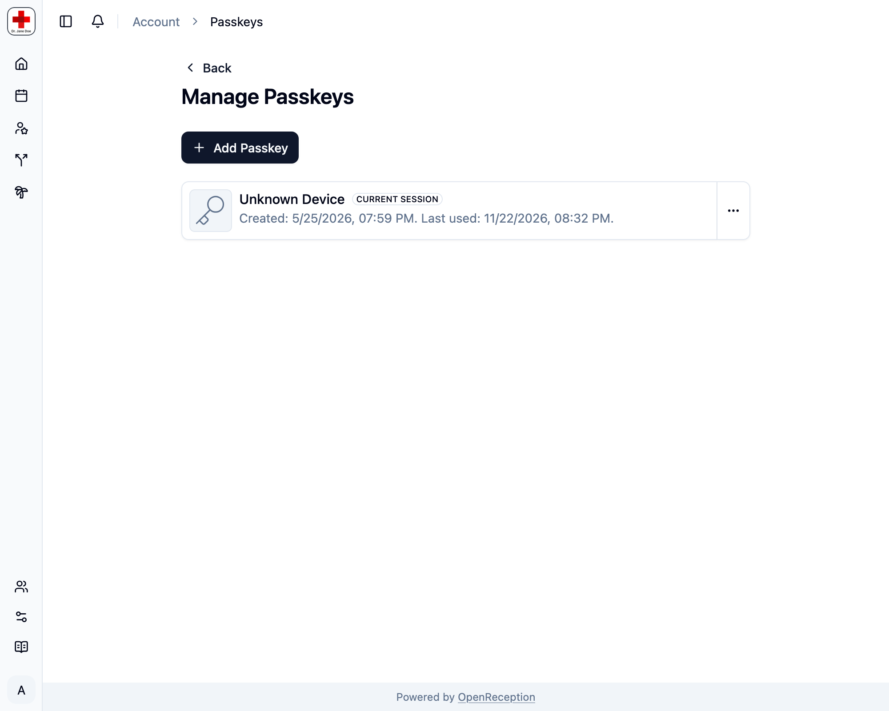
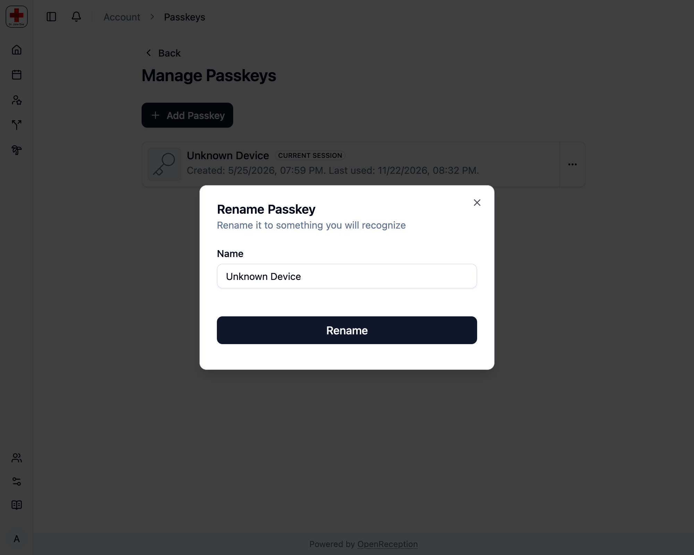
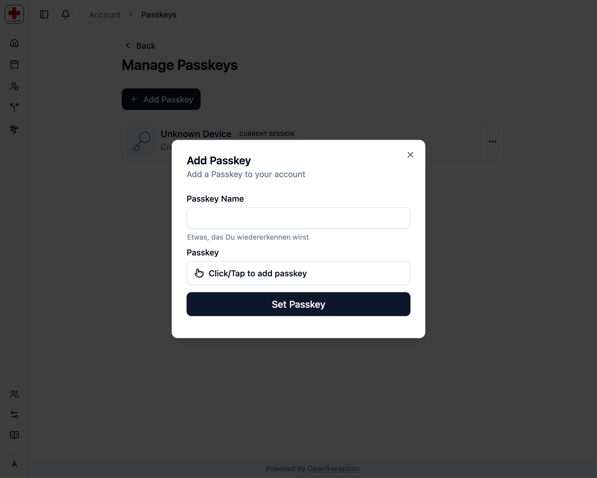

Auf der Seite _Passkeys verwalten_ kannst Du bis zu drei Passkeys für Dein Konto hinzufügen und verwalten. Für jeden Passkey kannst Du folgende Informationen sehen:

- einen Namen (ändere ihn, wenn Du möchtest)
- das Erstellungsdatum
- das letzte Verwendungsdatum
- ob er in Deiner aktuellen Sitzung verwendet wird

## Passkeys umbenennen

Öffne das Kontextmenü und wähle _Bearbeiten_. Du kannst für jeden Passkey einen Namen hinzufügen, damit Du ihn später leicht wiedererkennst. Dies ist nützlich, wenn Du mehrere Passkeys hast, was wir für Tenant Admins empfehlen.

## Passkey hinzufügen

Um einen neuen Passkey hinzuzufügen, klicke auf die Schaltfläche _Passkey hinzufügen_ und folge den Anweisungen. Du kannst bis zu drei Passkeys für Dein Konto hinzufügen.

Für weitere Anleitungen zum Hinzufügen eines Passkeys, [konsultiere den Abschnitt Konto einrichten](/de/account/setup-account), der Schritt-für-Schritt-Anweisungen bietet.

