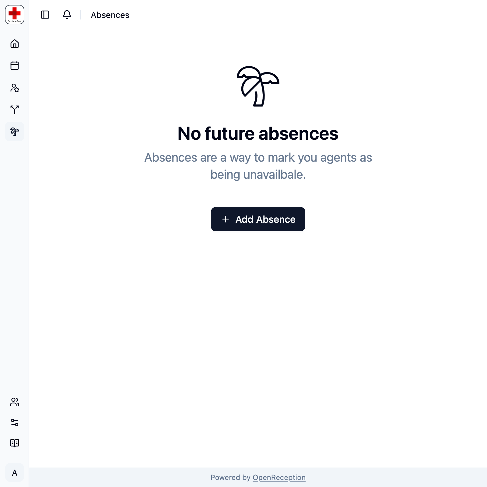
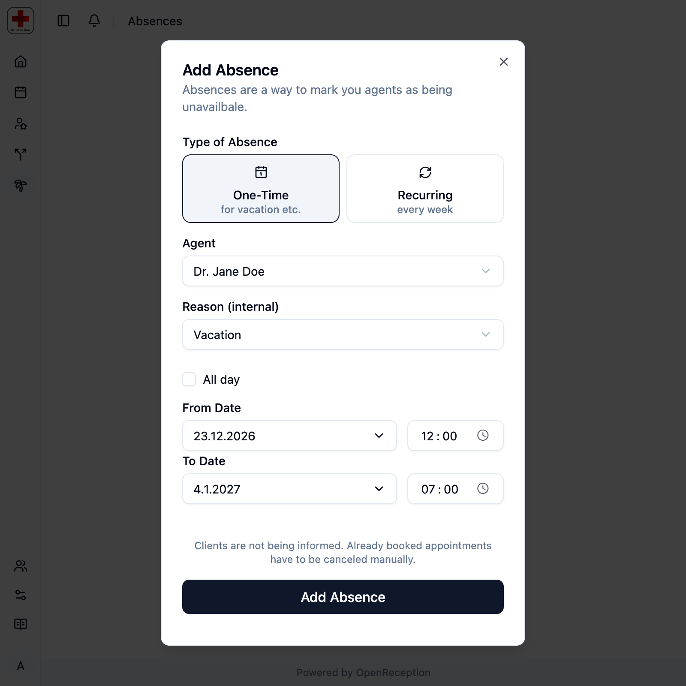
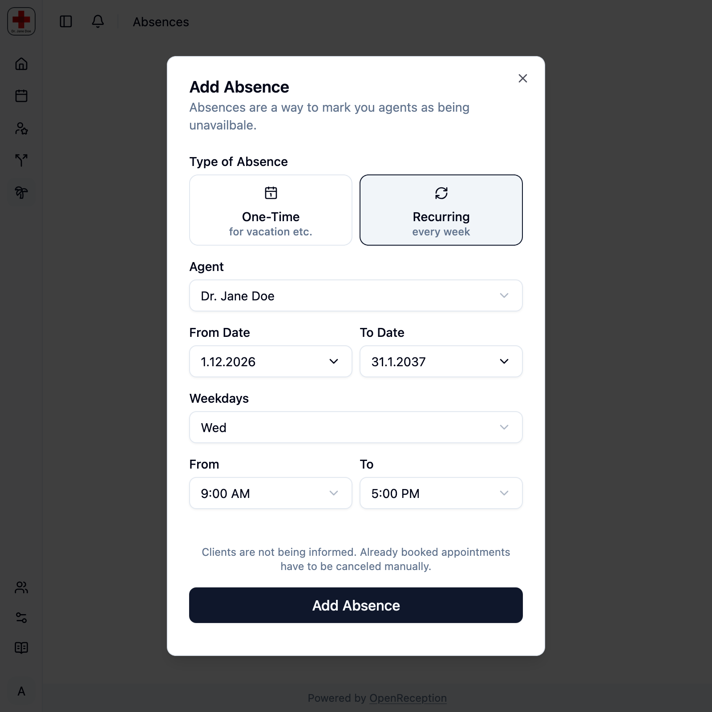
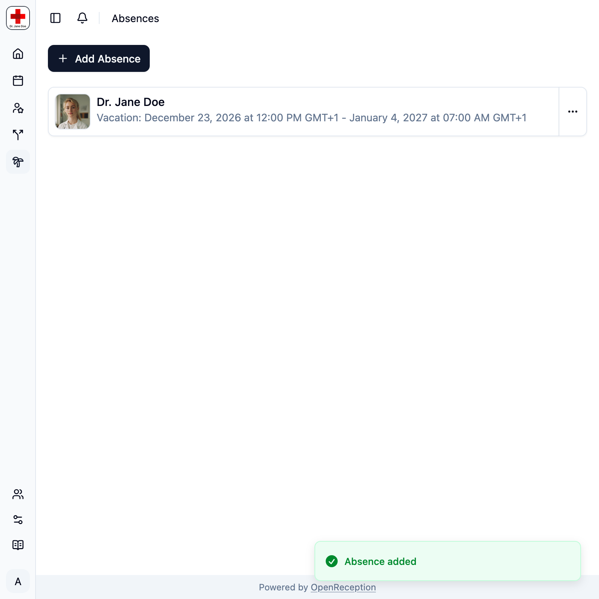
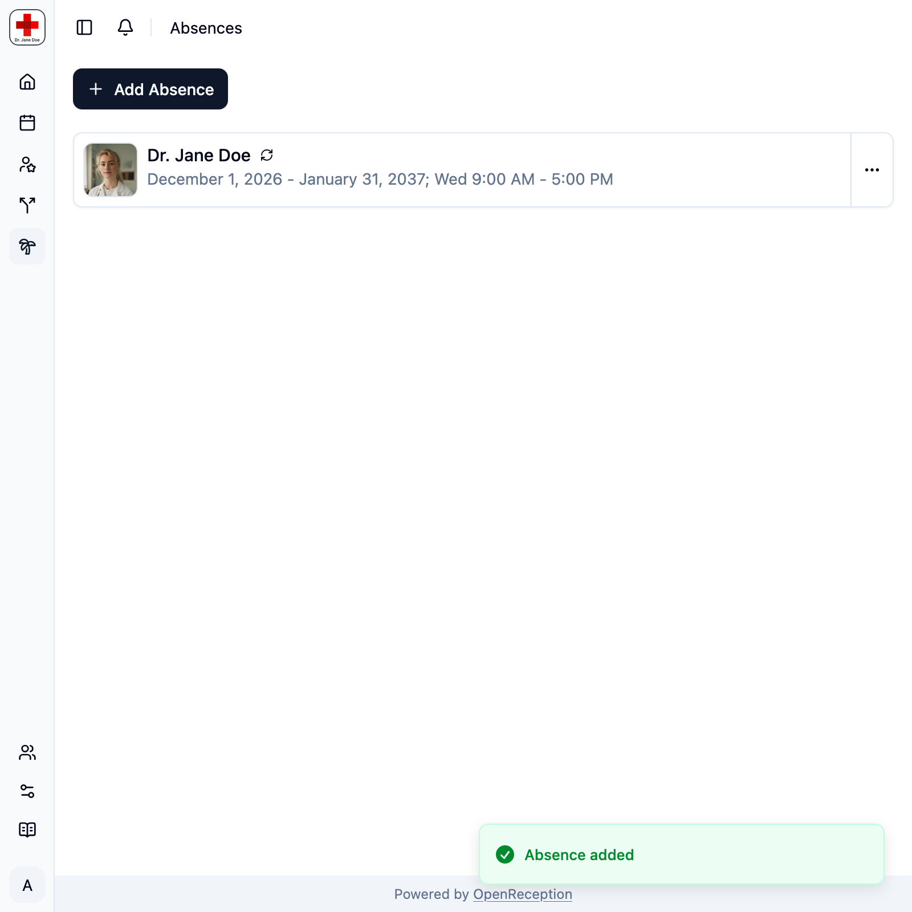

import {Steps} from "@astrojs/starlight/components";

<Steps>

1. Navigiere zum Abschnitt Abwesenheiten des Dashboards und klicke auf _Abwesenheit hinzufügen_

   

1. Ein Modal mit einem Formular wird geöffnet.
   - Wähle den **Typ** einmalig oder wiederkehrend
   - Wähle die abwesende **Akteur:in**
   - Ändere den **Grund**, wenn Du ihn hier verfolgen möchtest.
   - Wähle einen Zeitbereich für die Abwesenheit. Das **Enddatum** muss in der Zukunft liegen.

   

   Wenn Du eine wiederkehrende Abwesenheit ausgewählt hast, erscheinen zusätzliche Optionen für das Wiederholungsmuster:
   - Wähle den/die **Wochentag/e**
   - Wähle die **von** und **bis** Zeiten

   :::tip
   Um dies für einen längeren Zeitraum festzulegen, wähle ein **Enddatum** weit in der Zukunft.
   :::

   

1. Klicke auf _Abwesenheit hinzufügen_ und es wird gespeichert.
   

   Wiederkehrende Abwesenheiten haben ein kreisförmiges Symbol, das ihre Wiederholung kennzeichnet.

   

</Steps>
