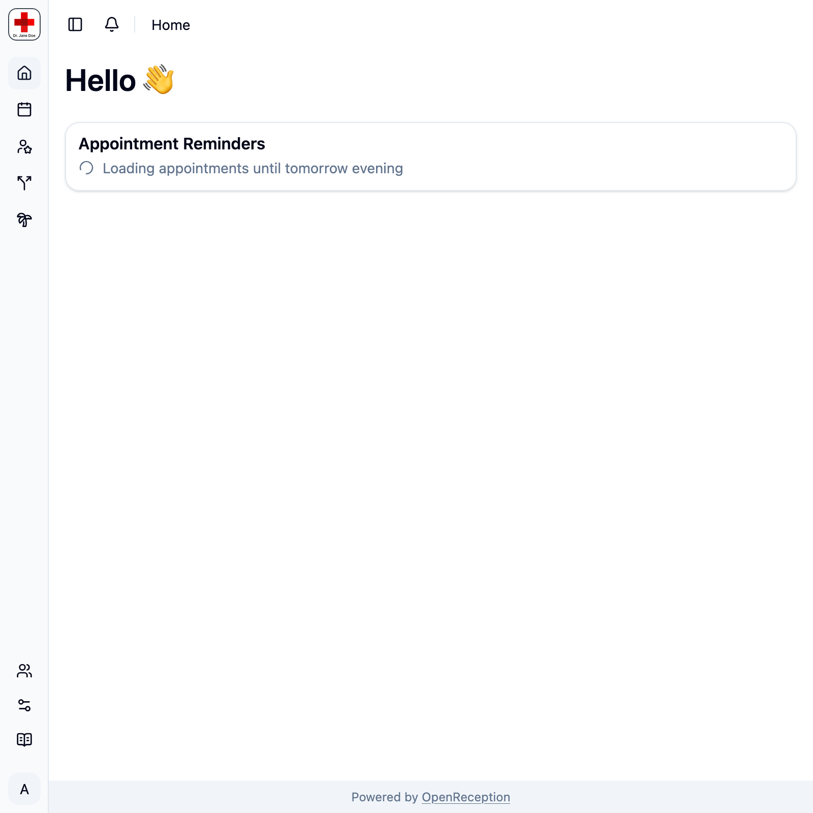

OpenReception unterstützt derzeit automatisierte Erinnerungen für Termine, wenn das Dashboard geöffnet wird.

## Halbautomatische Erinnerungen

Du musst die halbautomatischen Erinnerungen nicht einrichten, damit sie ausgeführt werden. Wenn Du Dich anmeldest, sendet OpenReception automatisch Erinnerungen für bevorstehende Termine.

Erinnerungen werden für Termine **heute und morgen** gesendet, wenn sie

- in der Zukunft liegen UND
- nicht heute gebucht worden sind UND
- die Klient:in Updates erhalten möchte UND
- noch nicht erinnert wurde.
