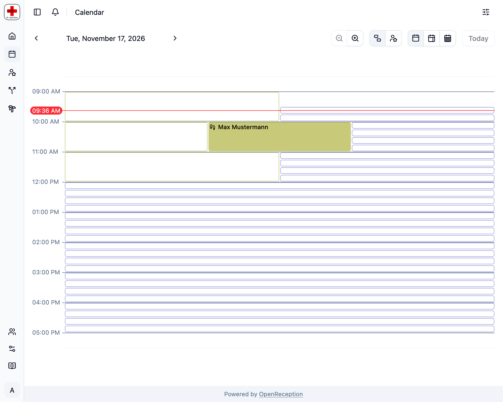
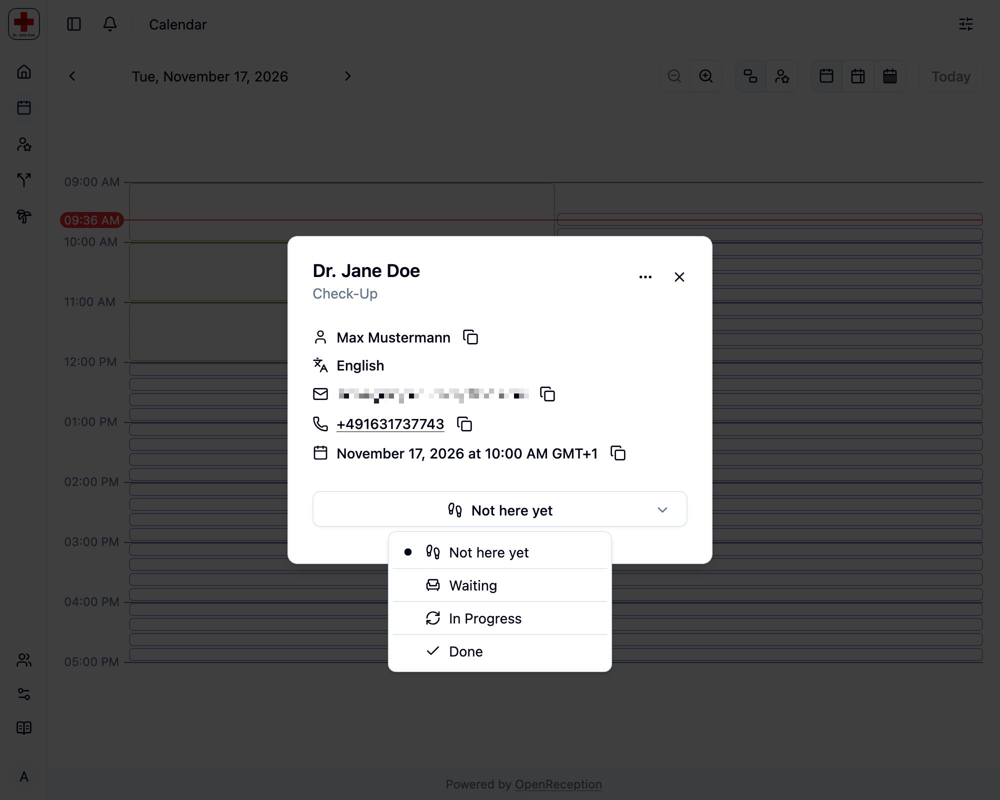
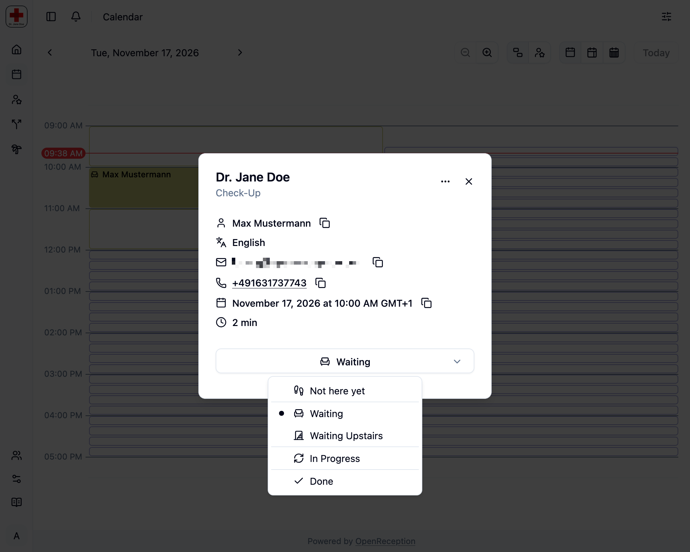
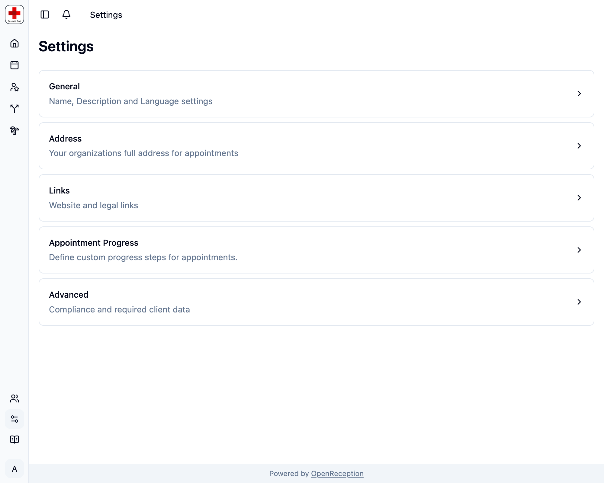
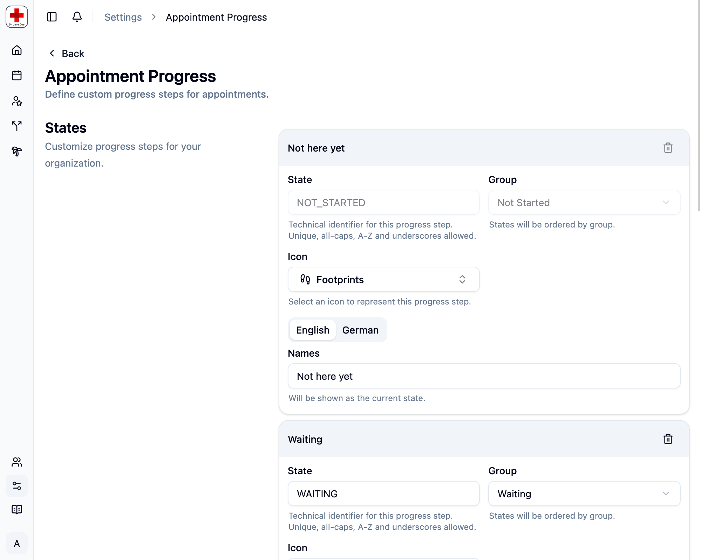
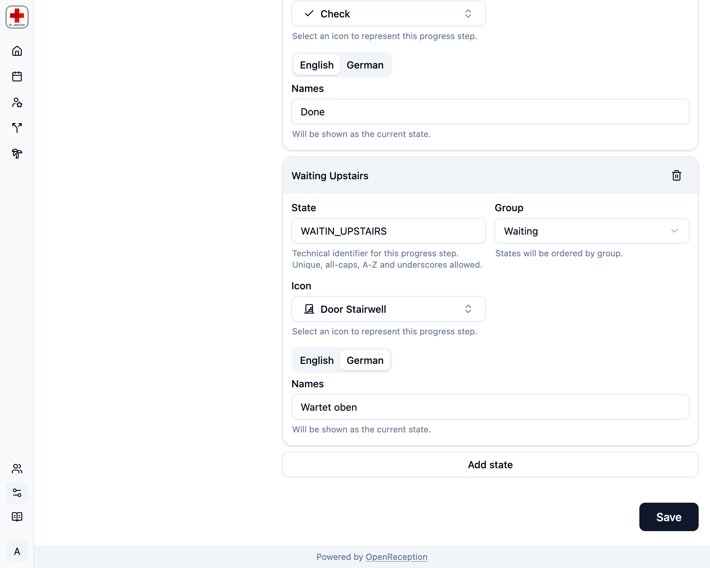
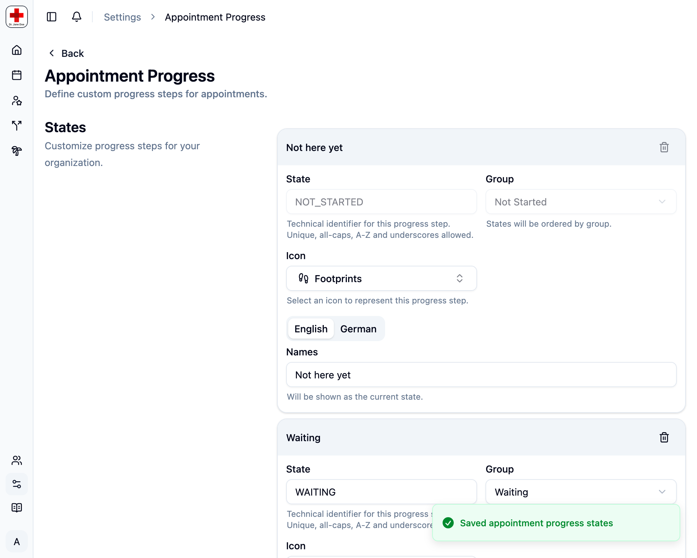
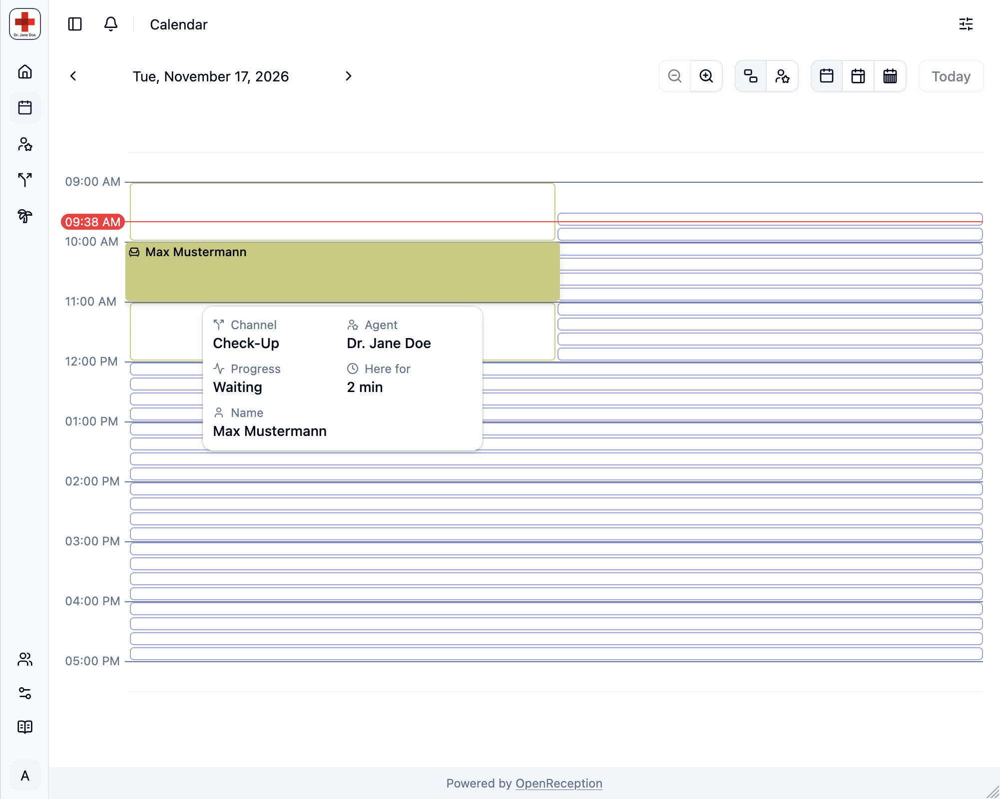

import {Badge} from "@astrojs/starlight/components";
import {Steps} from "@astrojs/starlight/components";

Wenn ein Termin heute stattfindet, wird der Terminfortschritt direkt in der Kalenderübersicht angezeigt.

Ein Fußspuren-Symbol wird auf dem heutigen Termin angezeigt:

Wenn Du auf den Termin klicken, kannst Du den Terminfortschritt ändern. Du hast folgende Optionen:

- Noch nicht da
- Wartet
- In Bearbeitung
- Erledigt

## Benutzerdefinierte Termin-Status <Badge text="Premium Funktion" variant="danger" />

Du kannst benutzerdefinierte Status für Deine Termine festlegen. So kannst Du den Fortschritt auf eine Weise verfolgen, die zu Deinem Workflow passt.

Du kannst benutzerdefinierte Status im Einstellungsbereich festlegen. Um sie zu verwalten

<Steps>

1. Navigiere zum Einstellungsbereich des Dashboards und klicke auf _Termin-Status_.

   

1. In den _Termin-Status_ Einstellungen kannst Du die Standard-Status verwalten und benutzerdefinierte hinzufügen.

   

1. Am Ende der Liste kannst Du einen neuen Status hinzufügen. Innerhalb eines Status kannst Du
   - Den **Status** festlegen, einen eindeutigen Namen für diesen Status
   - Die **Gruppe** festlegen, eine von **Noch nicht da**, **Wartet**, **In Bearbeitung** oder **Erledigt**
   - Das **Symbol** festlegen, das für diesen Status im Kalender angezeigt wird
   - Die **Namen** festlegen, die für diesen Status im Kalender angezeigt werden; lege sie für jede von Dir unterstützte Sprache fest

   

1. Klicke auf _Speichern_, um Deine Änderungen zu übernehmen.

   

</Steps>

## Wartezeit <Badge text="Premium Funktion" variant="danger" />

Zusätzlich wird die Wartezeit im Kalender angezeigt, entweder

- wenn Du mit der Maus über den Termin im Kalender fährst <Badge text="Plus Funktion" variant="danger" />
- oder im Termin-Details Modal.

Die Wartezeit beginnt automatisch, sobald der Terminfortschritt zum ersten Mal geändert wird.

