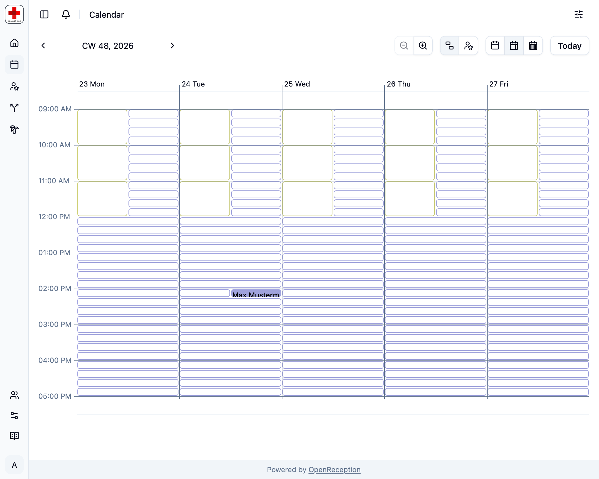
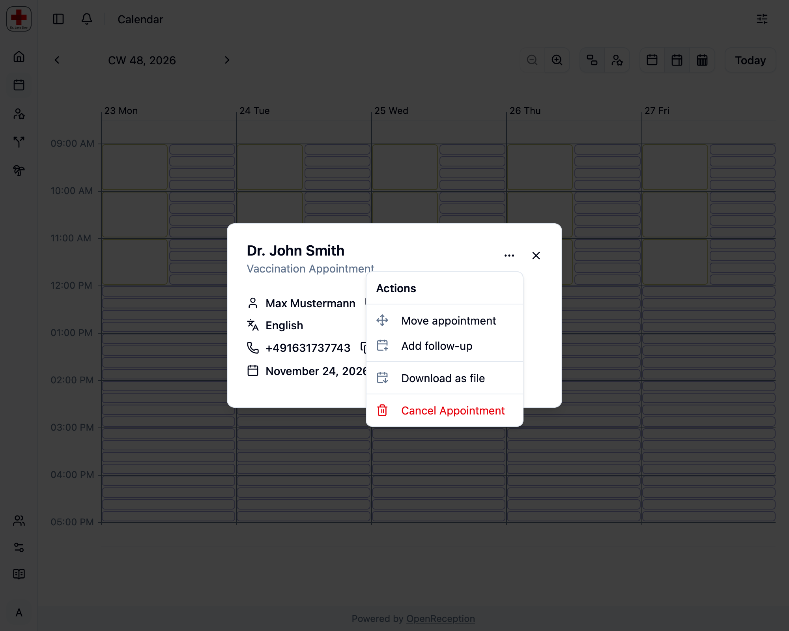
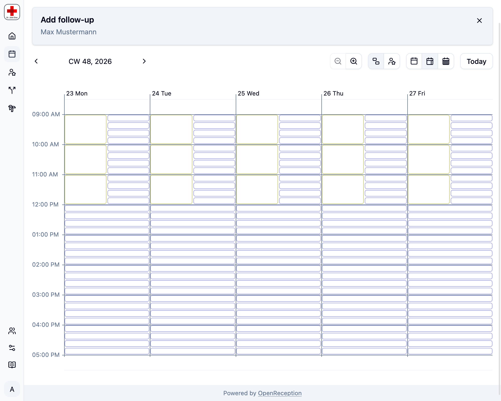
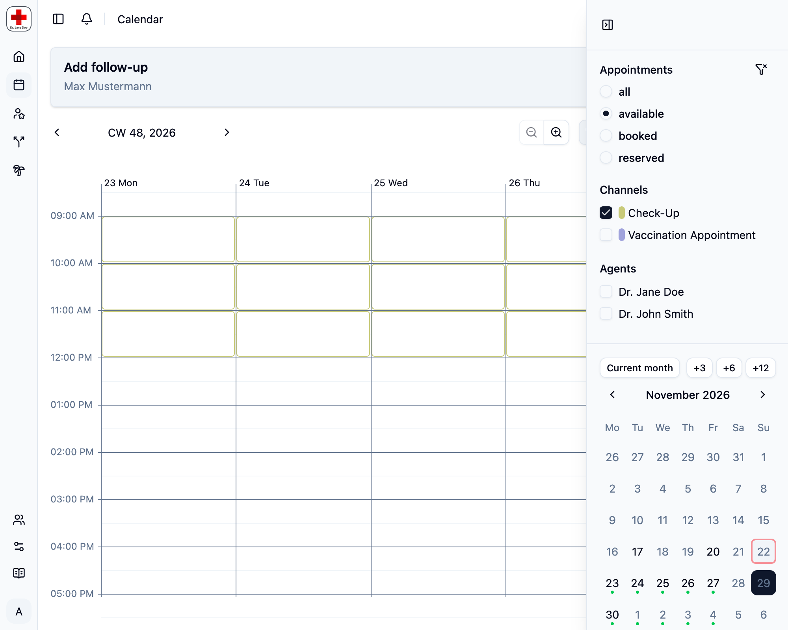
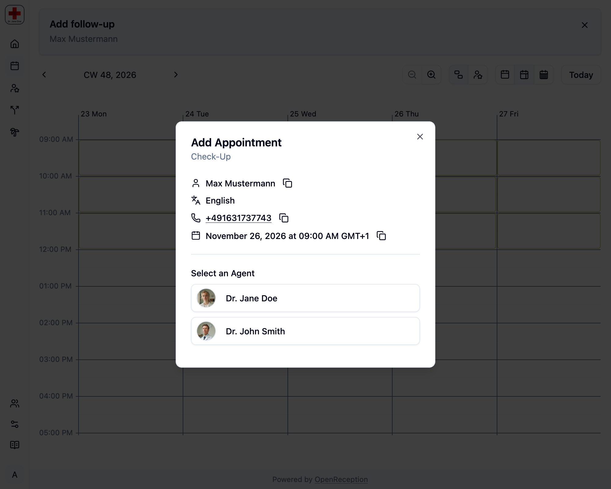
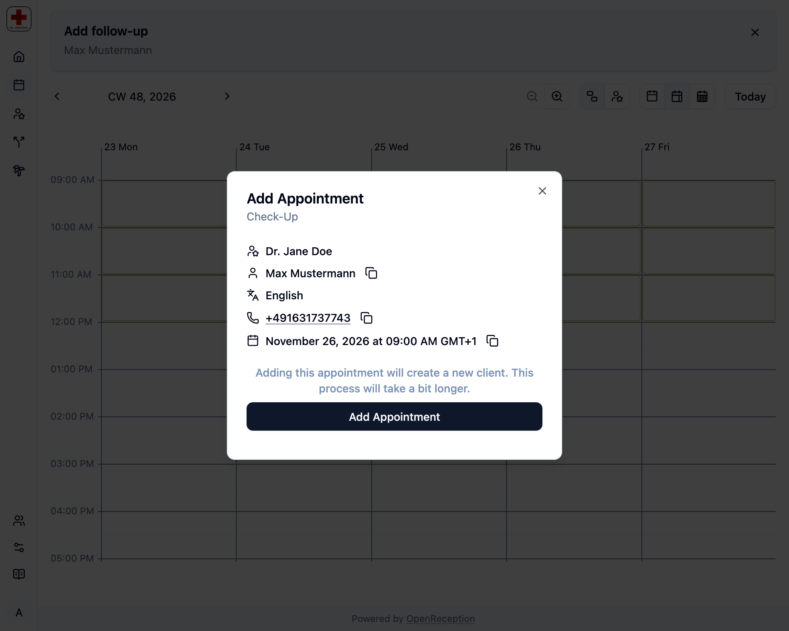
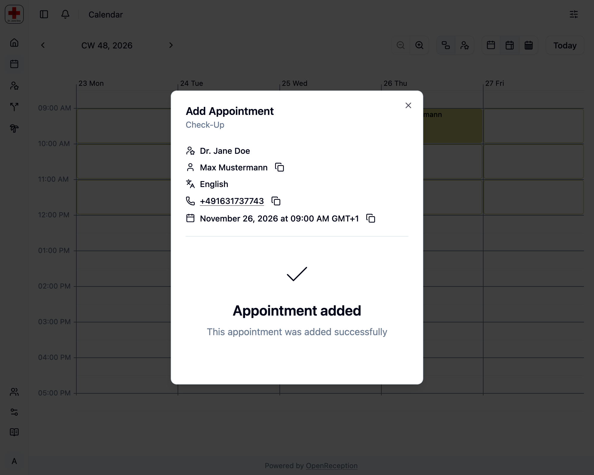
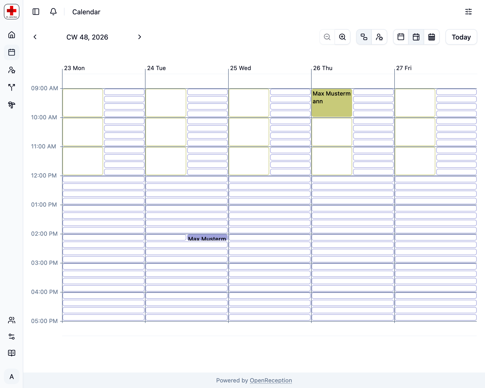

import {Steps} from "@astrojs/starlight/components";
import {Badge} from "@astrojs/starlight/components";

Du kannst einen Folgetermin über das Termin-Details Modal hinzufügen. Wir haben diesen Prozess so gestaltet, dass er schnell, intuitiv und barrierearm ist.

Führe die folgenden Schritte aus, um einen Folgetermin hinzuzufügen:

<Steps>
1. Navigiere zum Kalenderbereich des Dashboards, gehe zu dem Termin, für den du einen Folgetermin hinzufügen möchtest, und klicke darauf.

    

1. Das Termin-Details Modal wird geöffnet. Öffne das Kontextmenü in der oberen rechten Ecke (drei Punkte). Klicke auf _Folgetermin hinzufügen_.

   

1. Der Kalender wechselt in den _Folgetermin hinzufügen_-Modus, sodass du einen Zeitblock für den Folgetermin auswählen kannst. Du erkennst, dass du dich in diesem Modus befindest, wenn ein hervorgehobener Bereich über dem Kalender angezeigt wird.
   - Breche den Vorgang jederzeit ab, indem du auf das _X_-Symbol in der oberen rechten Ecke klickst.
   - Verwende den Kalender wie gewohnt, um einen Folgetermin hinzuzufügen.

   

1. Wenn du verfügbare Zeitblöcke nach Akteur:in oder anderen Kriterien filtern möchtest, öffne das Filter-Panel.

   

1. Wenn mehrere Akteur:innen verfügbar sind, wähle die bevorzugte Person aus.

   

1. Bestätige den Folgetermin.

   

1. Der Termin wurde nun hinzugefügt. Wenn die Klient:in im vorherigen Termin Benachrichtigungen aktiviert hatte, wird sie ebenfalls informiert. Das Modal bleibt geöffnet, damit du der Klient:in das neue Datum und die neue Uhrzeit mitteilen kannst, falls sie dies wünscht.

   

1. Wenn du das Modal schließt, siehst du den neuen Termin im Kalender.

   

</Steps>
