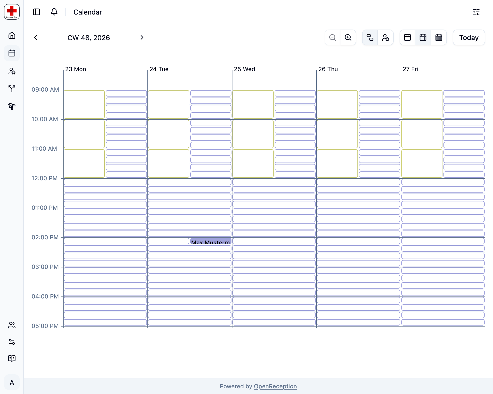
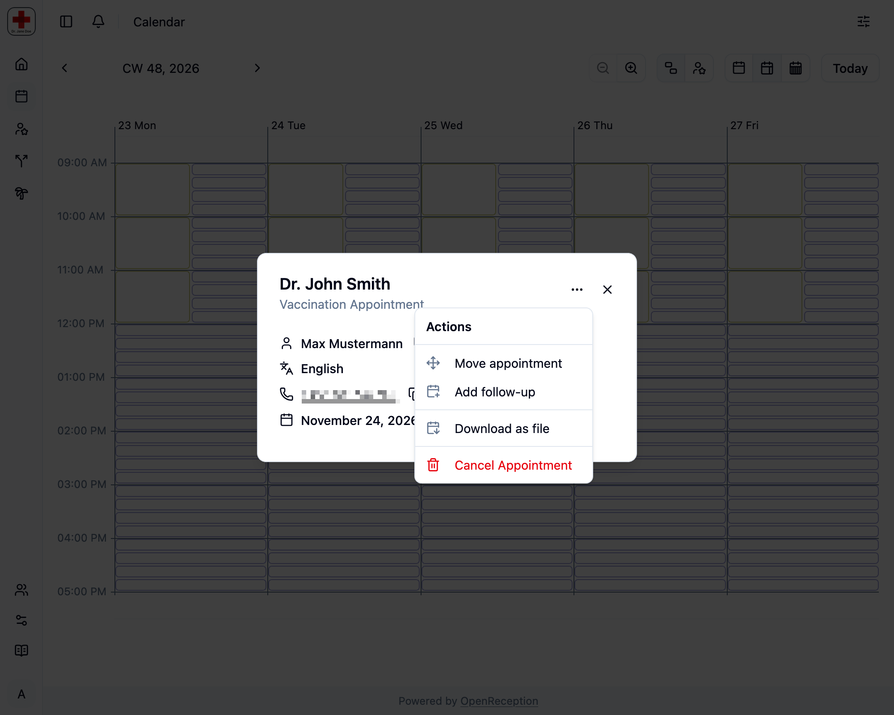
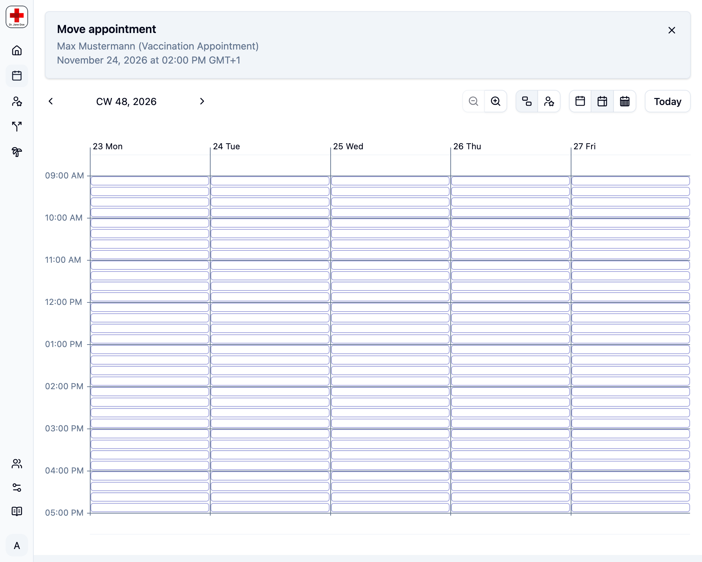
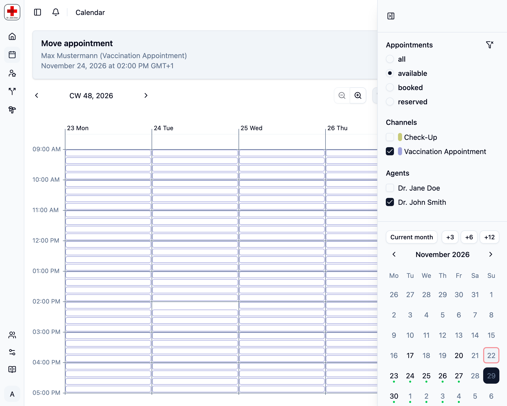
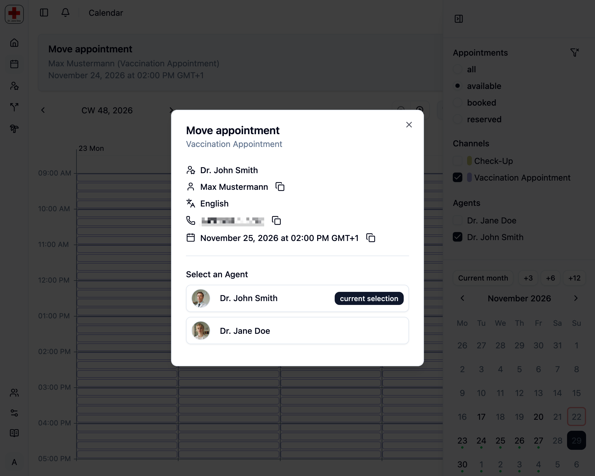
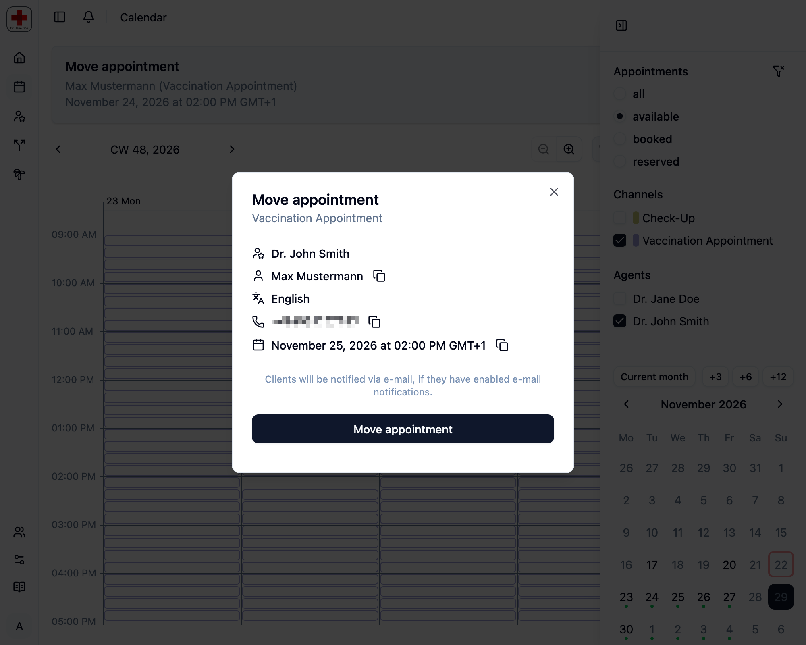
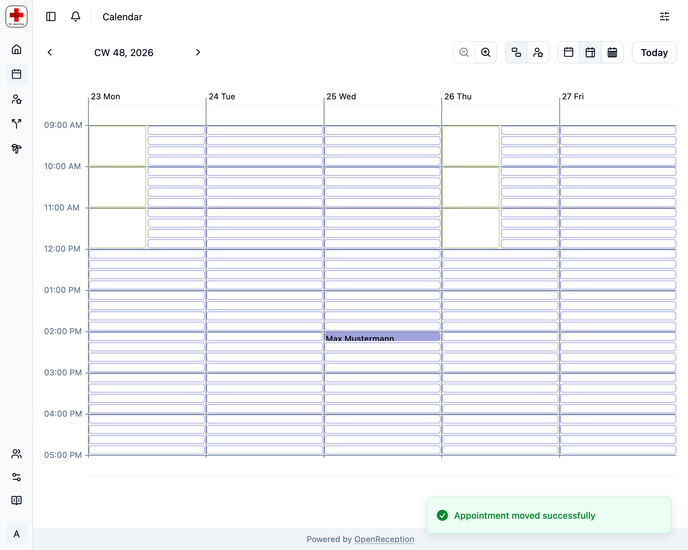

import {Steps} from "@astrojs/starlight/components";
import {Badge} from "@astrojs/starlight/components";

Du kannst das Datum und die Uhrzeit eines Termins im Termin-Details Modal ändern. Wir haben diesen Prozess so gestaltet, dass er schnell, intuitiv und barrierearm ist.

Beim Verschieben eines Termins kannst Du ihn in einem verfügbaren Zeitfenster platzieren und gleichzeitig die Verfügbarkeit der Mitarbeiter sehen.

Führe die folgenden Schritte aus, um einen Termin zu verschieben:

<Steps>
1. Navigiere zum Kalenderbereich des Dashboards, gehe zu dem Termin, den Du verschieben möchtest, und klicke darauf.

    

1. Das Termin-Details Modal wird geöffnet und zeigt das aktuelle Datum und die Uhrzeit des Termins an. Öffne das Kontextmenü in der oberen rechten Ecke (drei Punkte). Klicke auf _Termin verschieben_.

   

1. Der Kalender wechselt in den _Verschieben_-Modus, sodass Du ein neues Zeitfenster für den Termin auswählen kannst. Du erkennst, dass Du Dich in einem Modus befindest, wenn ein hervorgehobener Bereich über dem Kalender angezeigt wird.
   - Breche den Vorgang jederzeit ab, indem Du auf das _X_-Symbol in der oberen rechten Ecke klickst.
   - Verwende den Kalender wie gewohnt, um ein neues Zeitfenster für den Termin auszuwählen.

   

1. Wenn Du verfügbare Zeitfenster nach Akteur:in oder anderen Kriterien filtern möchtest, öffne das Filter-Panel.

   

1. Du kannst den Akteur:in direkt hier ändern. <Badge text="Premium Funktion" variant="danger" />

   

1. Bestätige das neue Zeitfenster.

   

1. Der Termin wird in das neue Zeitfenster verschoben und eine Benachrichtigung wird angezeigt. Wenn der Kunde Benachrichtigungen aktiviert hat, wird er ebenfalls über die Änderung informiert.

   

</Steps>
