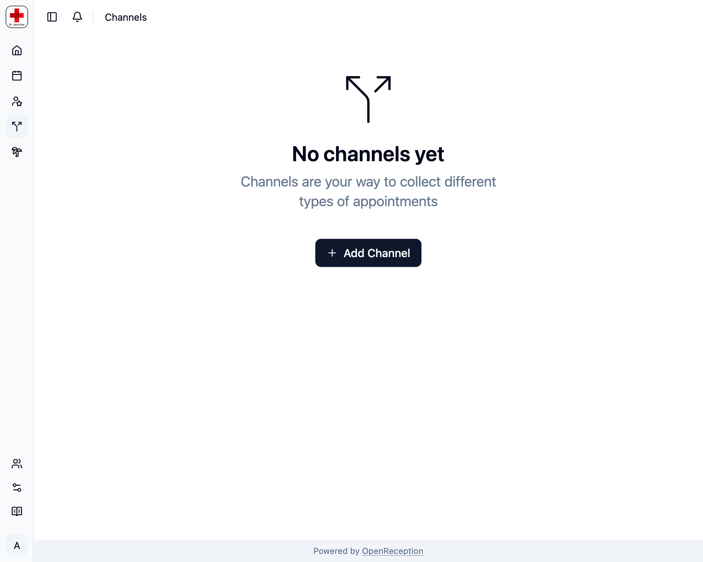
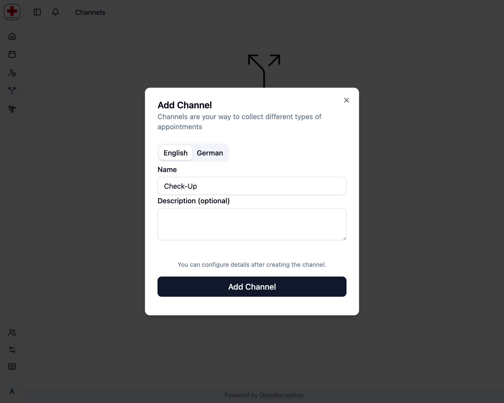
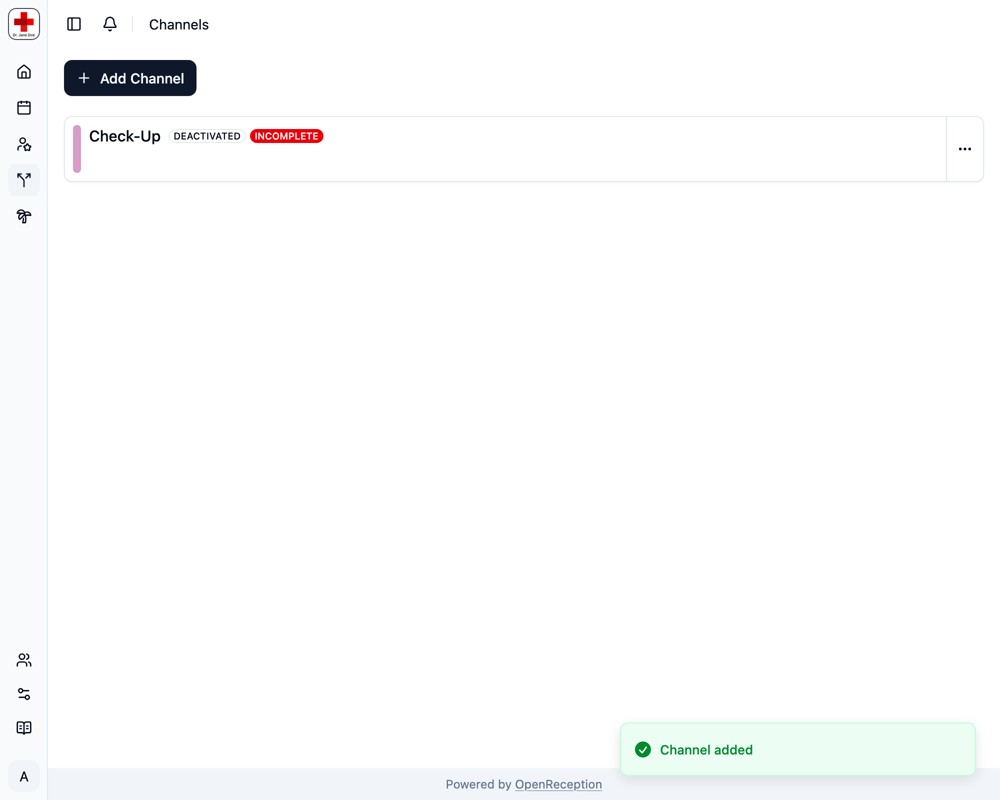

import {Steps} from "@astrojs/starlight/components";

:::note
Vor dem Hinzufügen eines Kanals stelle sicher, dass Du [alle Mandanten-Sprachen konfiguriert hast](../../settings/base-settings).
:::

<Steps>

1. Navigiere zum Bereich Kanäle im Dashboard und klicke auf _Kanal hinzufügen_

   

1. Ein Modal mit einem Formular öffnet sich. Füge einen **Namen** und eine **Beschreibung** in allen Deinen Sprachen hinzu.

   

1. Klicke dann auf _Kanal hinzufügen_ damit er gespeichert wird.

   

</Steps>

Du hast erfolgreich einen neuen Kanal hinzugefügt. Er wird nicht öffentlich angezeigt, bis Du Akteure sowie einen Zeitplan hinzugefügt und ihn aktiviert hast. [Bearbeite einen Kanal](/de/channels/edit-channel), um diese Änderungen vorzunehmen.
