import {Steps} from "@astrojs/starlight/components";
import {Badge} from "@astrojs/starlight/components";

:::note
Wenn Du Beschreibungen verwendest und Sprachen hinzugefügt hast, seit Du einen Kanal zuletzt bearbeitet hast, kannst Du Deine Änderungen nur speichern, wenn Du Beschreibungen in allen fehlenden Sprachen hinzufügst.
:::

<Steps>

1. Navigiere zum Bereich Kanäle im Dashboard, suche nach dem Kanal, den Du bearbeiten möchtest, und öffne das Kontextmenü. Klicke auf _Bearbeiten_.

   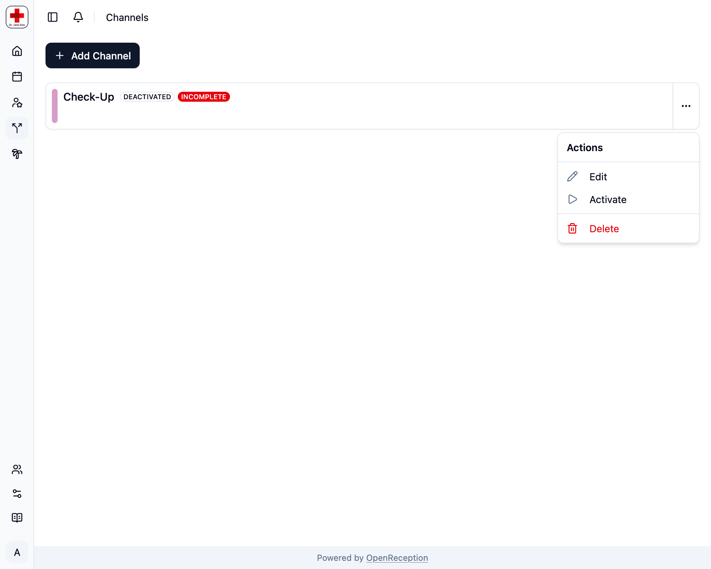

1. Wenn Dein Kanal nicht vollständig eingerichtet ist, wird jeder erforderliche Schritt mit einem roten Indikator versehen.

   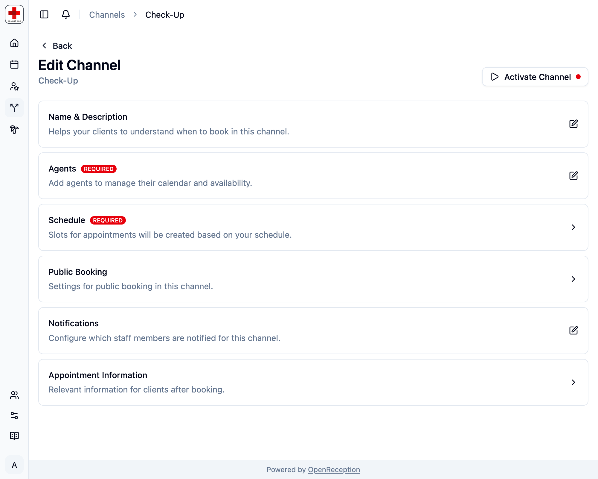

1. Klicke auf jeden Abschnitt, den Du bearbeiten möchtest, und nimm Deine Änderungen vor.

</Steps>

## Name & Beschreibung

Klicke auf den Abschnitt _Name & Beschreibung_, um den Namen und die Beschreibung des Kanals zu bearbeiten.

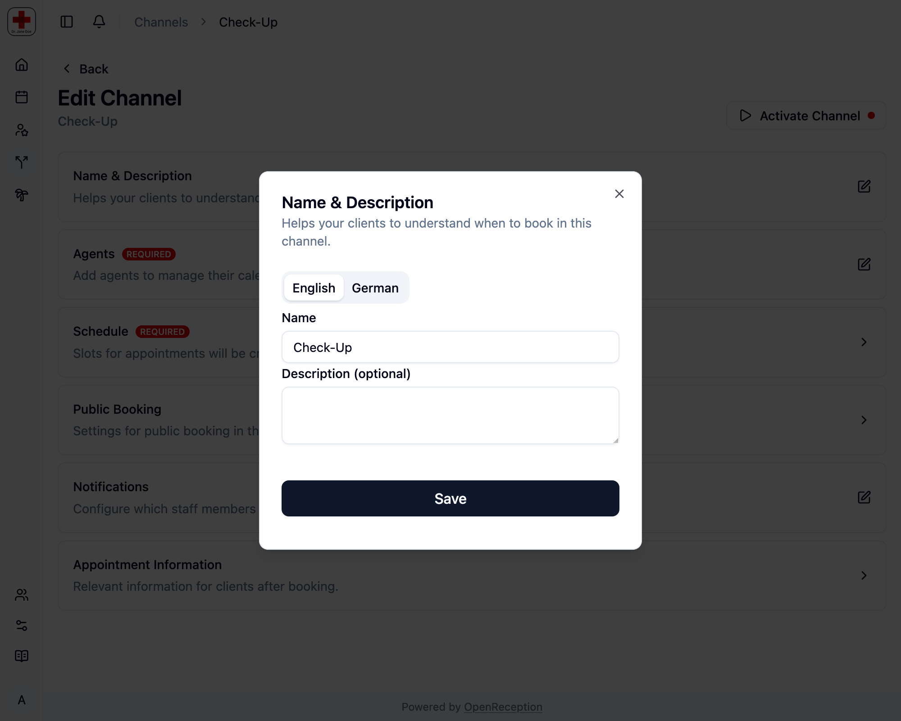

## Akteure

Klicke auf den Abschnitt _Akteure_, um die Akteure zu bearbeiten, die Termine in diesem Kanal durchführen können. Wenn Klienten Akteure automatisch auswählen, werden sie in der Reihenfolge ausgewählt, die Du in dieser Liste festgelegt hast.

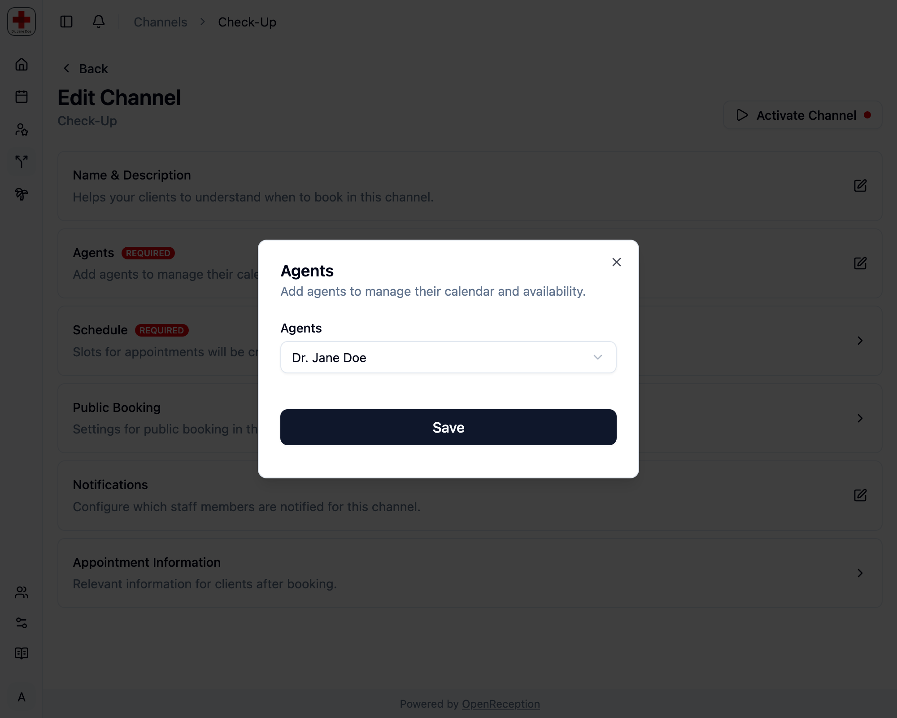

## Zeitplan

Klicke auf den Abschnitt _Zeitplan_, um den Zeitplan für diesen Kanal zu bearbeiten. Du kannst so viele Zeitplanvorlagen hinzufügen, wie Du benötigst. Für jede Vorlage kannst Du Folgendes festlegen:

- Wochentage
- Startzeit
- Endzeit
- Dauer

Terminslots werden automatisch basierend auf den von Dir definierten Zeitplanvorlagen erstellt.

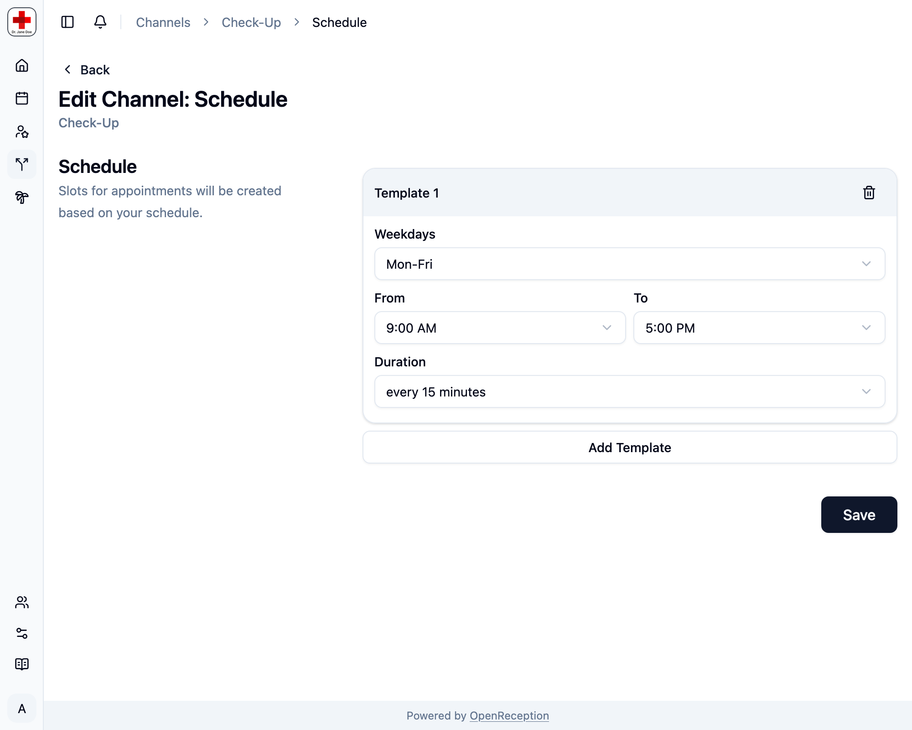

## Öffentliche Buchung

In diesem Abschnitt kannst Du konfigurieren, wie Klienten, die die öffentliche Buchung verwenden, mit diesem Kanal interagieren können.

- Ändere, ob dieser Kanal **öffentlich** sein soll. Wenn er nicht öffentlich ist, kannst Du Termine nur über den [Kalender](/de/calendar) hinzufügen.
- Ändere, ob Termine eine **Bestätigung erfordern**. Du wirst vom [Benachrichtigungssystem](/de/staff/notifications) benachrichtigt, wenn eine neue Anfrage hinzugefügt wird.
- Füge [Fristen](#fristen) für die Interaktion mit Klienten hinzu.

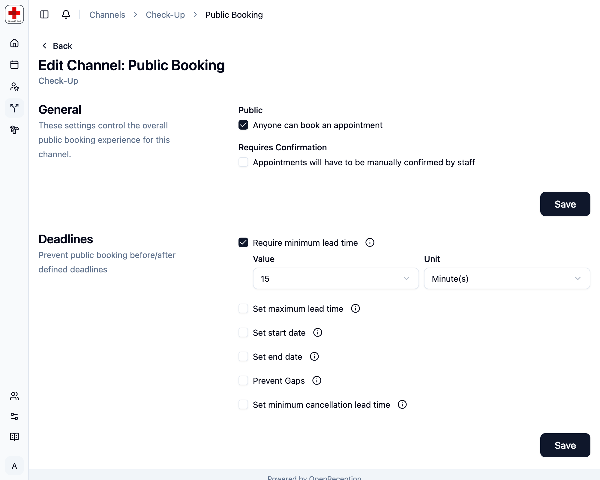

### Fristen

Lege fest, wann bestimmte Aktionen erlaubt sind. Du kannst die folgenden Fristen festlegen:

- **Erfordert minimale Vorlaufzeit:** Minimale Zeit, die ein Termin im Voraus gebucht werden muss
- **Erfordert maximale Vorlaufzeit:** Maximale Zeit, die ein Termin im Voraus gebucht werden kann
- <Badge text="Premium-Feature" variant="danger" /> **Startdatum festlegen:**
  Absolutes Datum und Uhrzeit, ab wann Termine gebucht werden können.
- <Badge text="Premium-Feature" variant="danger" /> **Enddatum festlegen:**
  Absolutes Datum und Uhrzeit, bis zu dem Termine gebucht werden können.
- <Badge text="Premium-Feature" variant="danger" /> **Lücken verhindern:**
  Erlaubt nur Termine, die zum Startzeitpunkt des Kanals oder nach bestehenden
  Terminen gebucht werden; 5min Toleranz; über alle Termine hinweg.
- <Badge text="Premium-Feature" variant="danger" /> **Absage-Frist festlegen:**
  Mindestfrist, um einen Termin online zu stornieren.

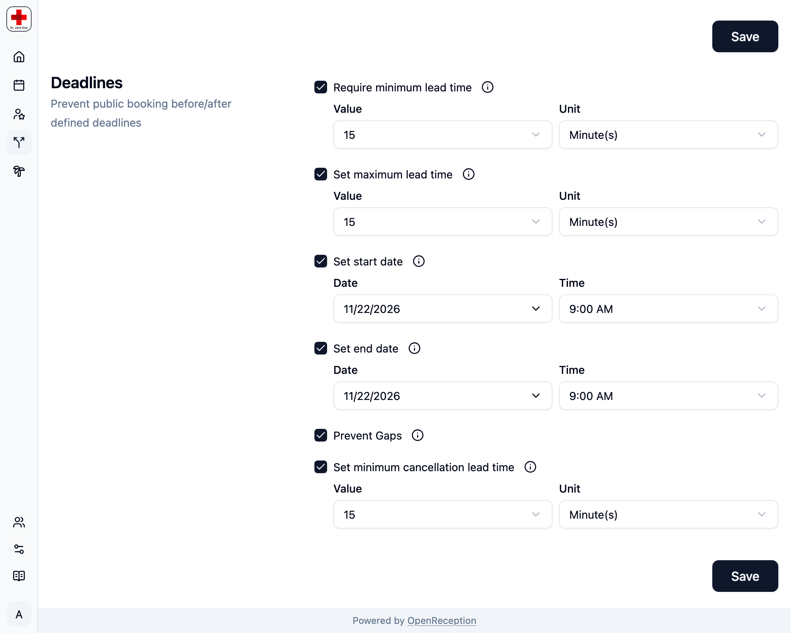

## Benachrichtigungen

Lege fest, welche Mitarbeiter Benachrichtigungen für diesen Kanal erhalten sollen. Siehe die [Benachrichtigungsdokumentation](/de/staff/notifications) für weitere Details.

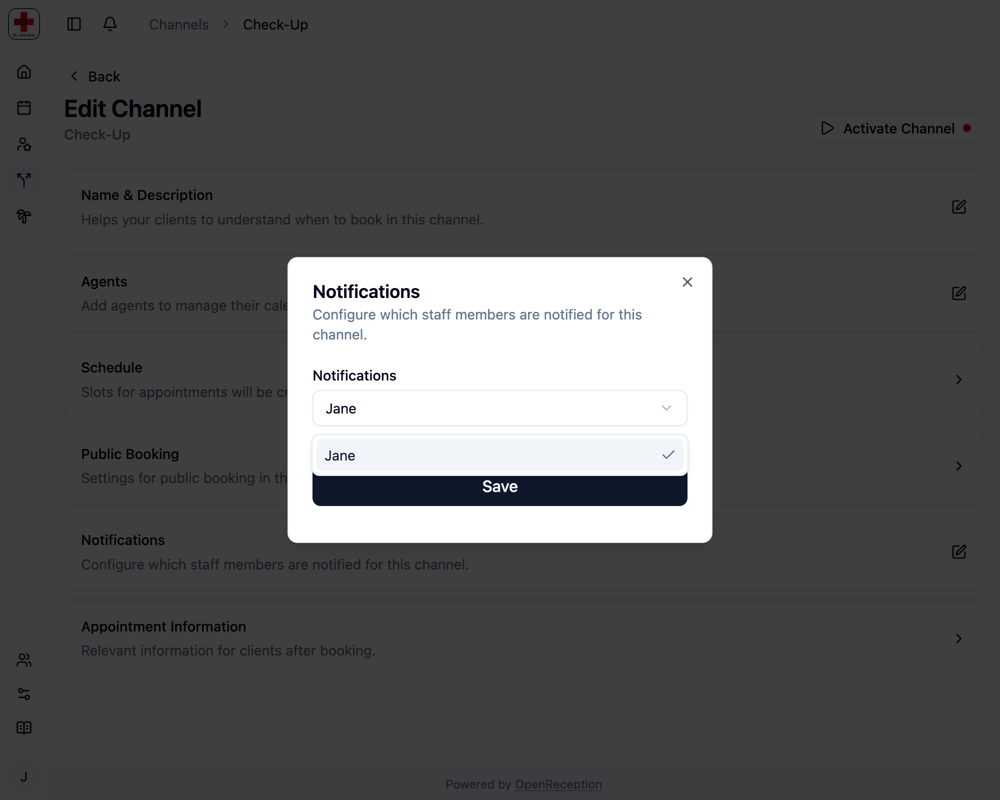

## Termin-Informationen <Badge text="Plus-Feature" variant="danger" />

Termin-Informationen sind für Klienten sichtbare Details, die diese nach der Buchung eines Termins sehen. Du kannst die folgenden Informationen festlegen:

- **Text:** Verwende dies, um zusätzliche Informationen oder Anweisungen für Klient:innen bezüglich ihres Termins bereitzustellen.
- **Links:** Verwende dies, um relevante Links für Klient:innen bezüglich ihres Termins bereitzustellen, wie z.B. Online-Anamnesebögen.
- **Video-Raum:** Stelle einen Link zu einem Video-Konferenzraum für den Termin bereit. Dieser Link ist für alle Termine in diesem Kanal derselbe.

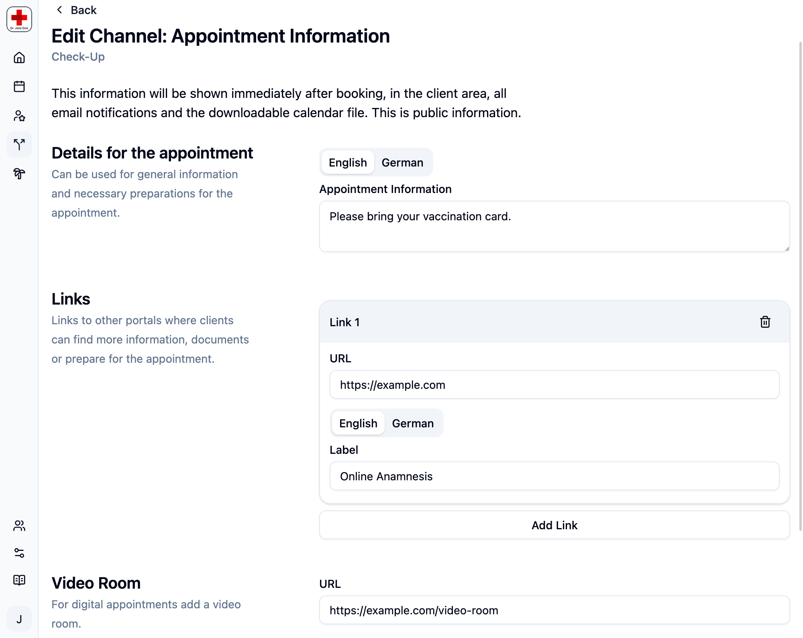

Diese Informationen werden an verschiedenen Kontaktpunkten im Buchungserlebnis der Klient:innen angezeigt:

- Direkt nach der Buchung auf der Bestätigungsseite
- In den Termindetails auf dem Klienten-Dashboard
- In der E-Mail zur Terminanfrage
- In der E-Mail zur Terminbestätigung
- In den Erinnerungen per E-Mail
- In allen Kalenderdateien (via Download oder E-Mail-Anhang)

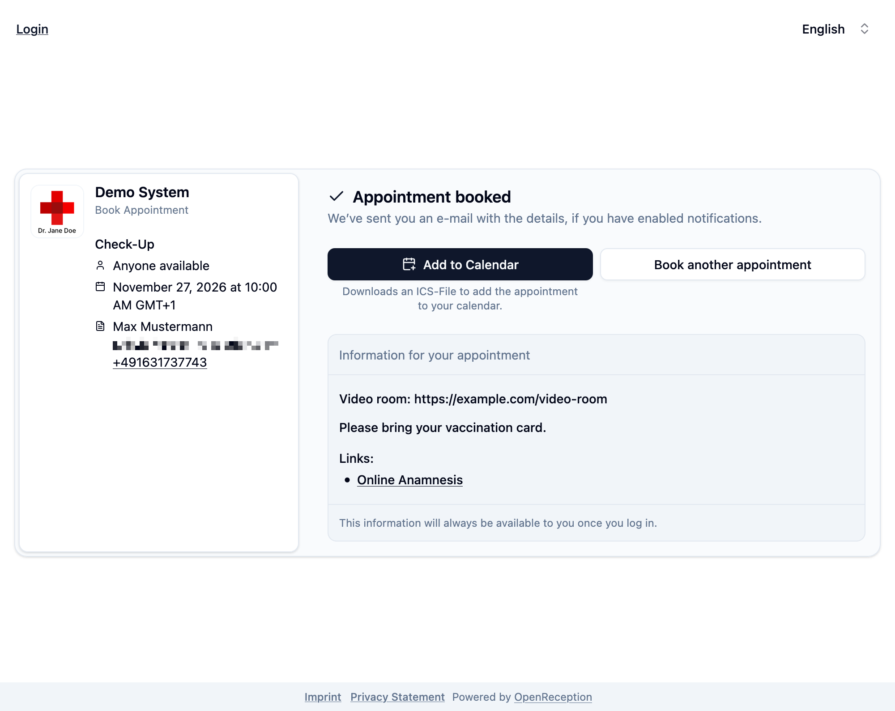

## Kanal aktivieren/deaktivieren

Du kannst diesen Kanal über die Schaltfläche oben rechts aktivieren oder deaktivieren. Wenn ein Kanal deaktiviert ist, steht er nicht für Buchungen zur Verfügung.

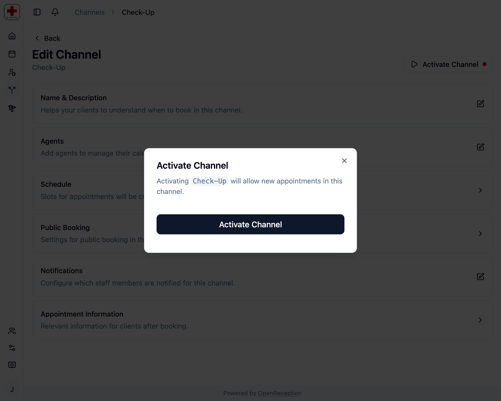
