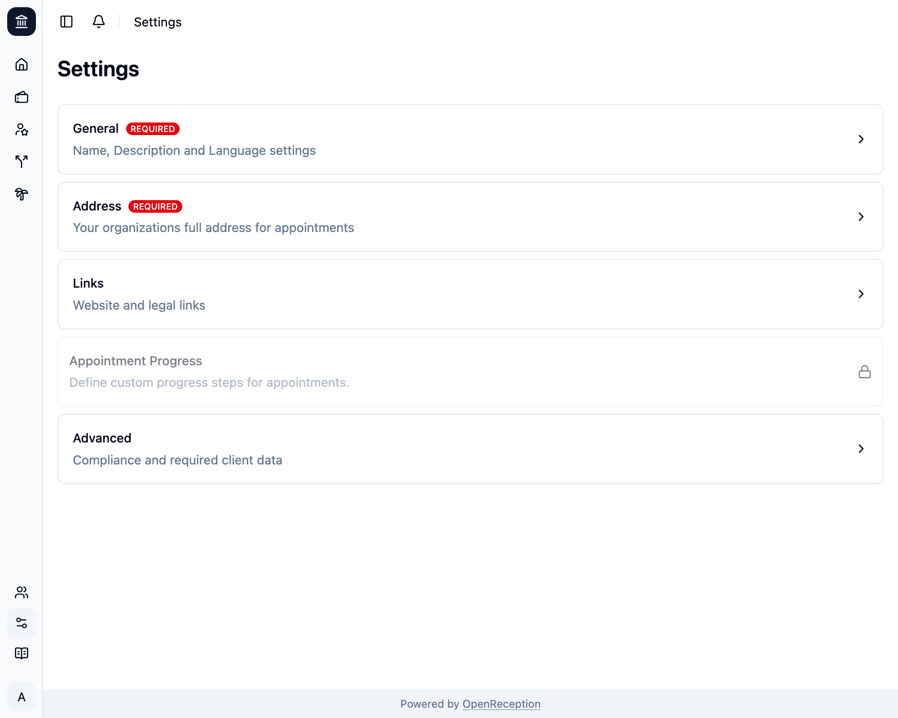
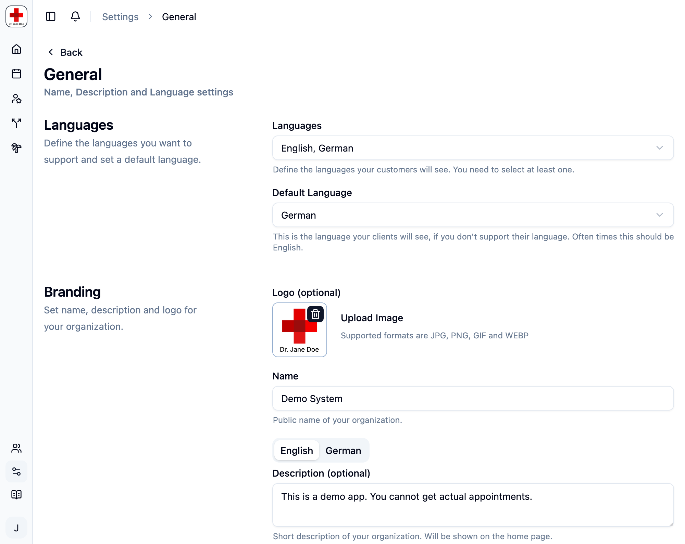
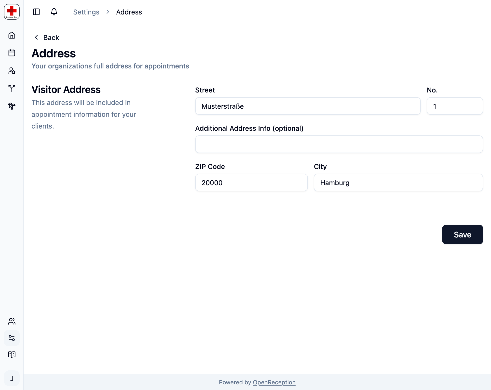
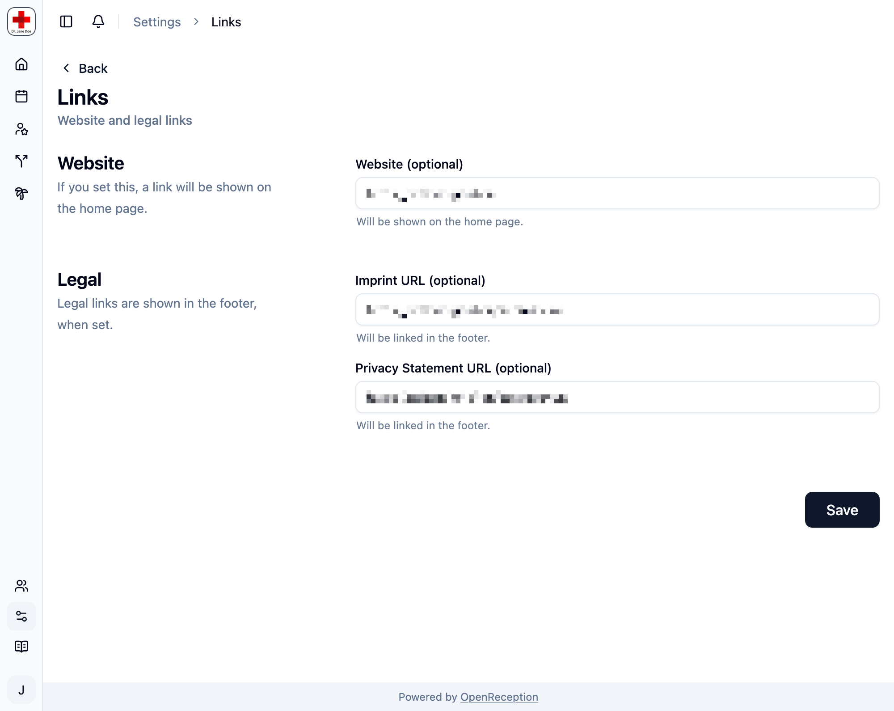
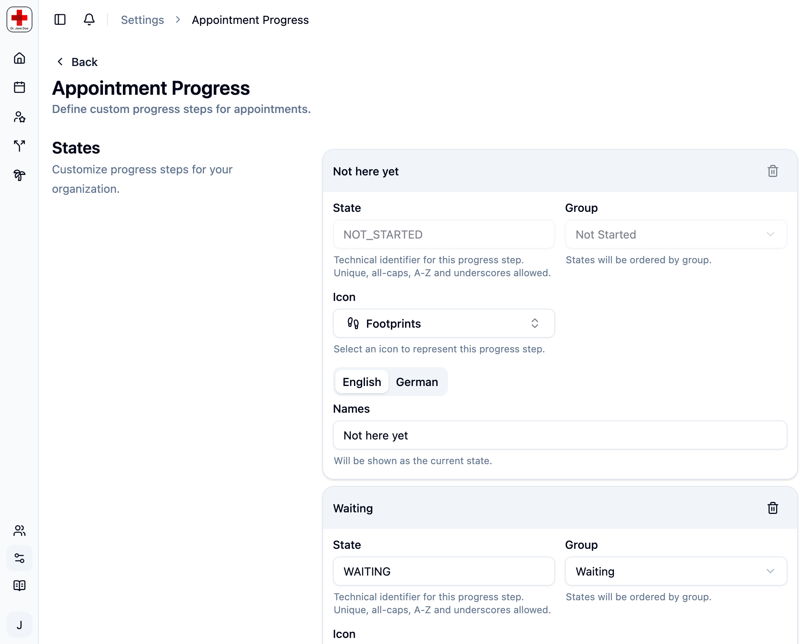
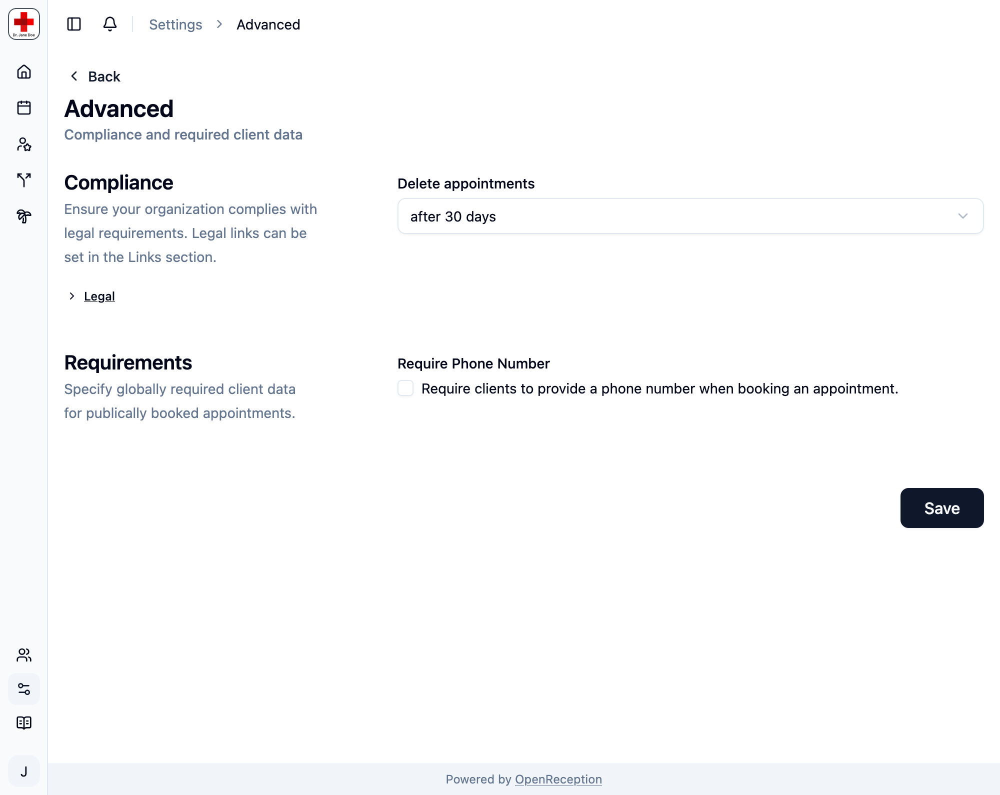

import {Badge} from "@astrojs/starlight/components";

Wenn Du zum Einstellungsbereich des Dashboards navigierst, hast Du einen Überblick über die möglichen Mandanten-Einstellungen.

## Allgemein

:::caution
Wenn Du Sprachen hinzufügst, nachdem Du die Beschreibung Deiner Organisation (im gleichen Formular), Akteure:innen oder Kanäle eingerichtet hast, solltest Du diese erneut aufrufen, um die fehlenden Übersetzungen hinzuzufügen.
:::

Du kannst die folgenden Grundeinstellungen für Deine öffentliche Terminbuchungsseite vornehmen:

- Die **unterstützten Sprachen** einstellen
- Die **Standardsprache** festlegen
- Den **Namen Deiner Organisation** festlegen
- Ein **Bild/ Logo** hochladen
- Eine **Beschreibung für Deine Organisation** hinzufügen

## Adresse

Füge eine **Adresse** für Deine Organisation hinzu: Sie wird in Bestätigungs-E-Mails und heruntergeladenen Kalendereinträgen angezeigt.

## Links

Füge **Links** wie Deine Website, Dein Impressum und Deine Datenschutzrichtlinie hinzu.

## Termin-Status <Badge text="Premium Funktion" variant="danger" />

Du kannst benutzerdefinierte Termin-Status für Deine Organisation festlegen. Erfahre mehr in der [Kalender-Dokumentation](/de/calendar/appointment-progress).

## Erweitert

Lege fest, **wann vergangene Termine gelöscht werden sollen** oder ob Klient:innen ihre **Telefonnummer** zum Termin hinzufügen müssen.

