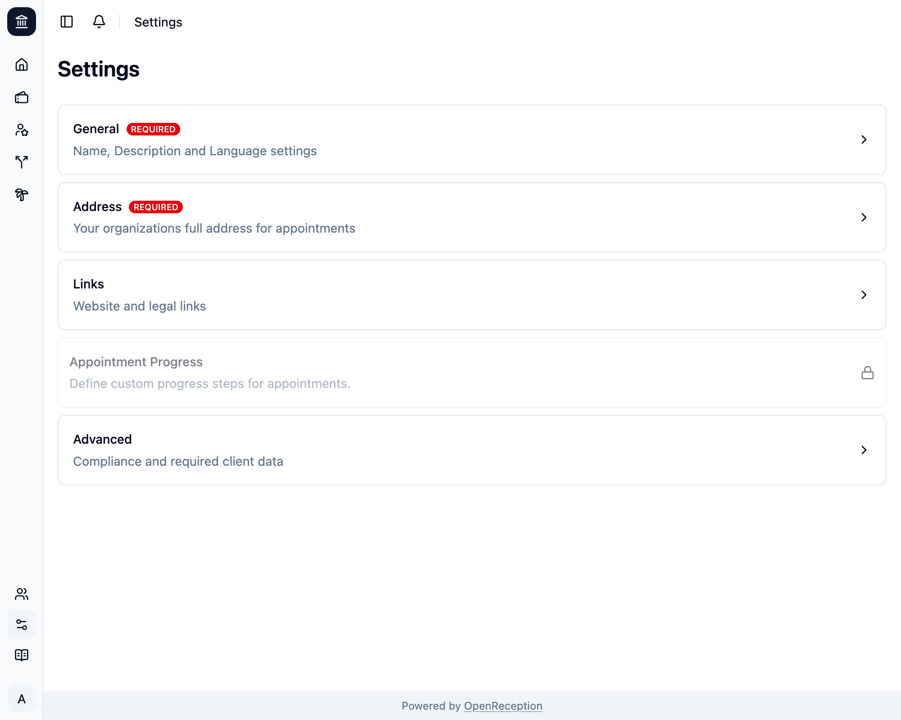
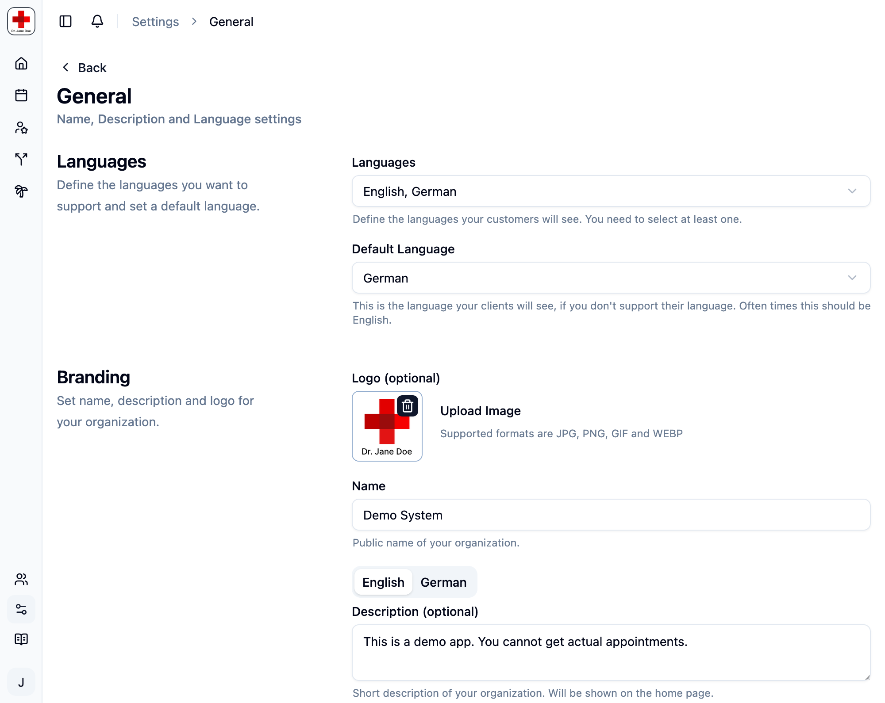
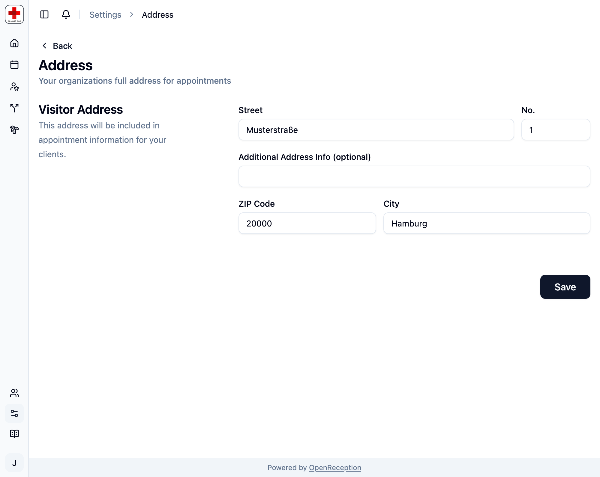
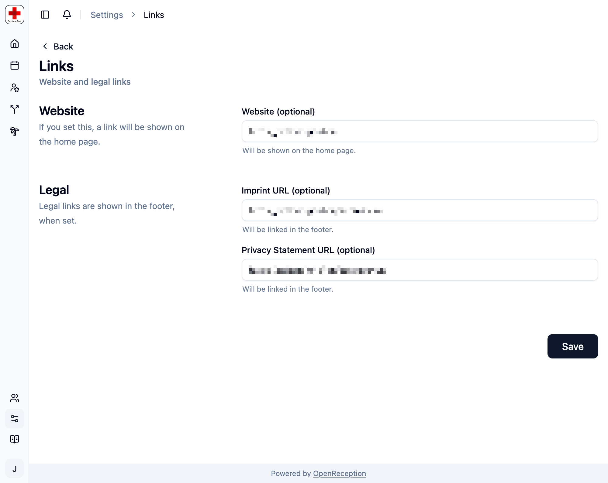
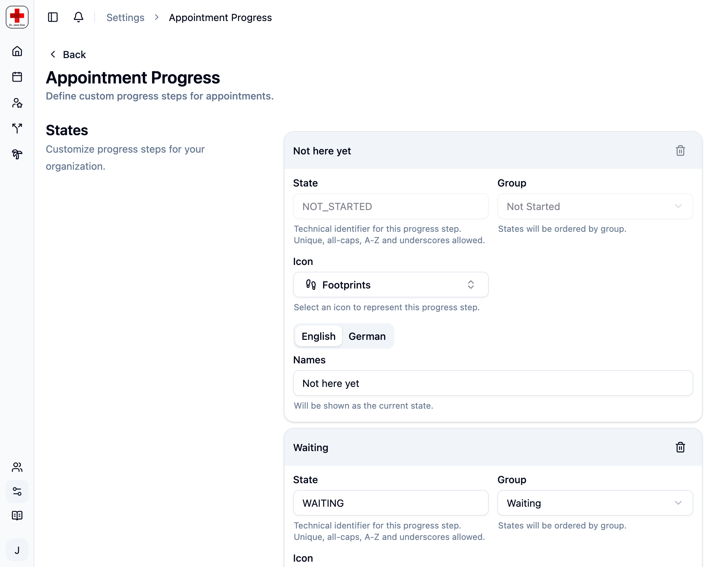
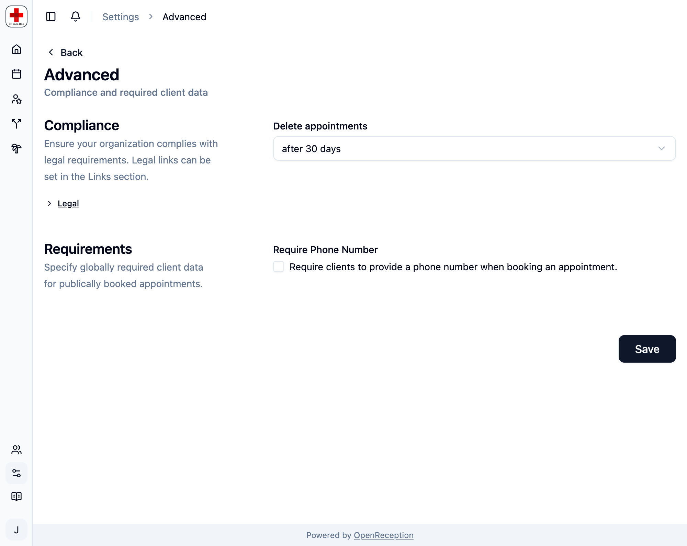

import {Badge} from "@astrojs/starlight/components";

When you navigate to the settings section of the dashboard, you will see the settings overview. General settings and an address are required.

## General

:::caution
If you are adding languages after you've set up your organizations description (within the same settings form), agents or channels, you should revisit them to add the missing translations.
:::

You can make the following basic settings for your public facing appointment booking page:

- Change the **supported languages**
- Set the **default language**
- Set the **name of your organization**
- Upload an **image/ logo**
- Add a **description for your organization**

## Address

Add an **address** for your organization: It will appear in confirmation e-mails and downloaded calendar events.

## Links

Add **links** like your website, imprint, and privacy policy.

## Appointment Progress <Badge text="Premium Feature" variant="danger" />

You can define custom appointment progress statuses for your organization. Learn more in the [calendar documentation](/calendar/appointment-progress).

## Advanced

Define **when past appointments should be deleted** or require clients to add their **phone number** to the appointment

