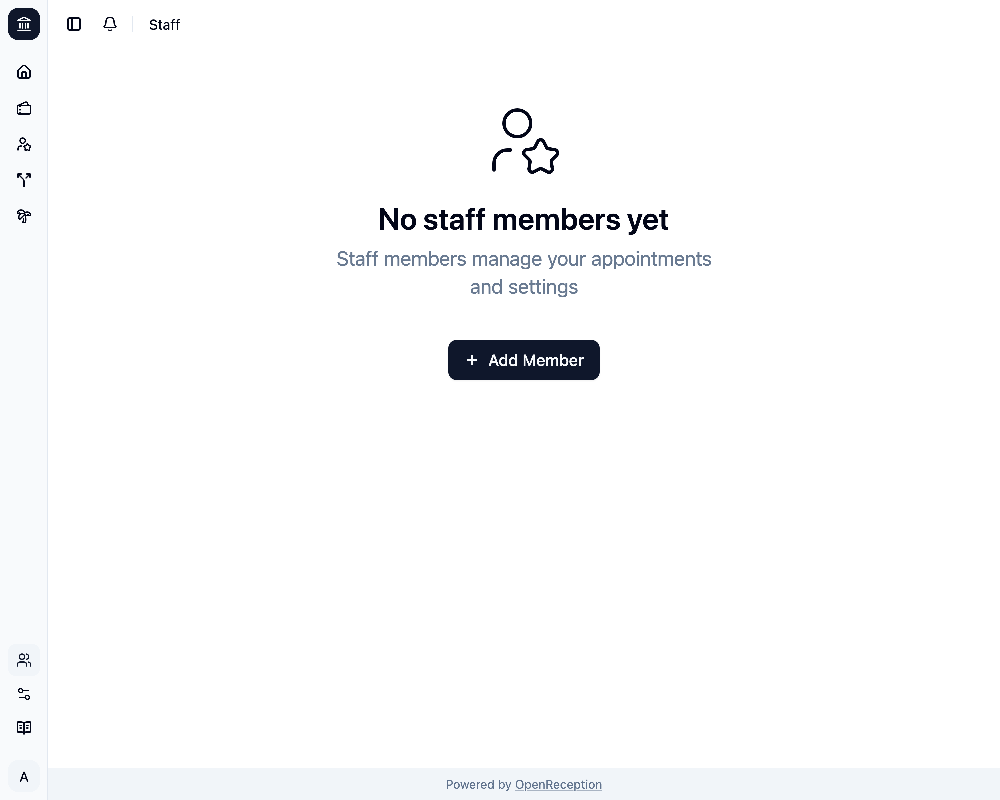
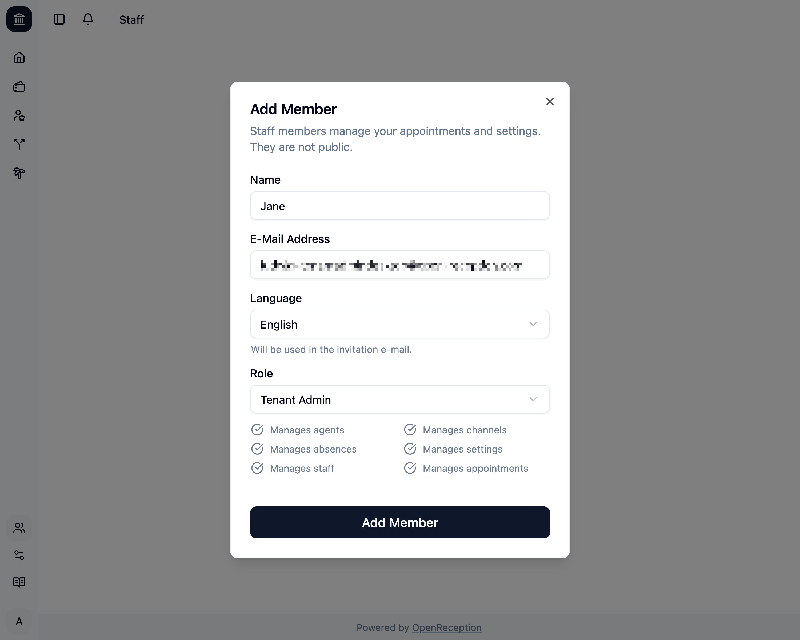
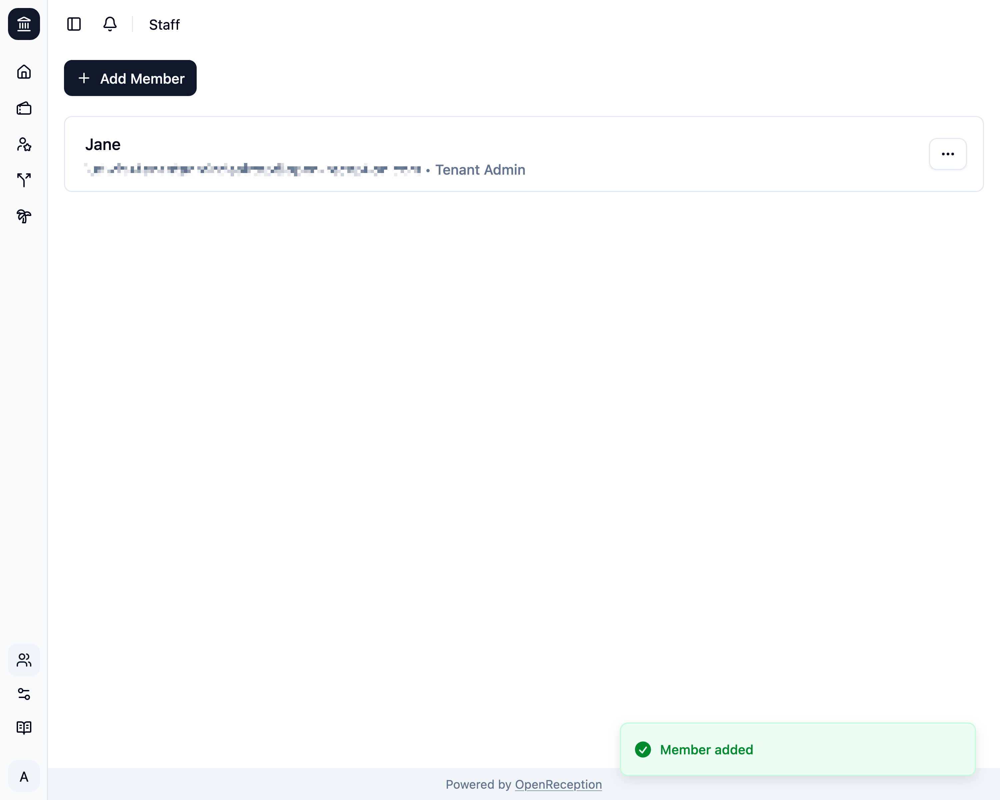
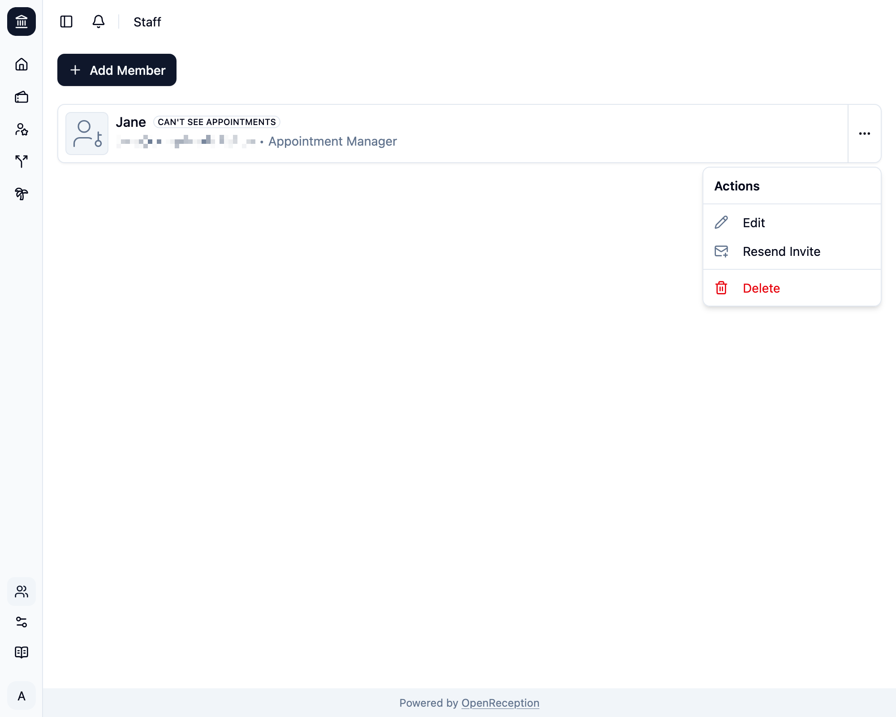
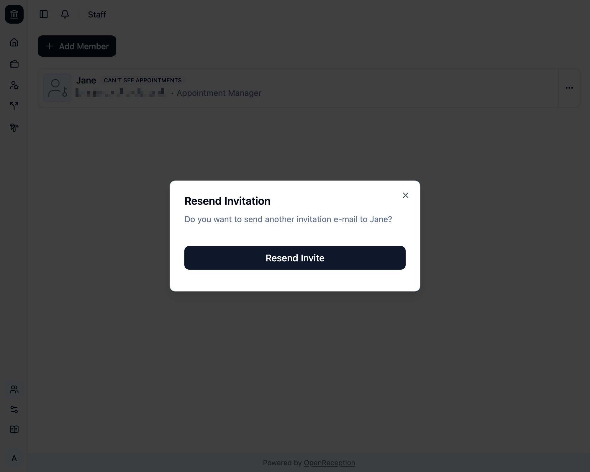
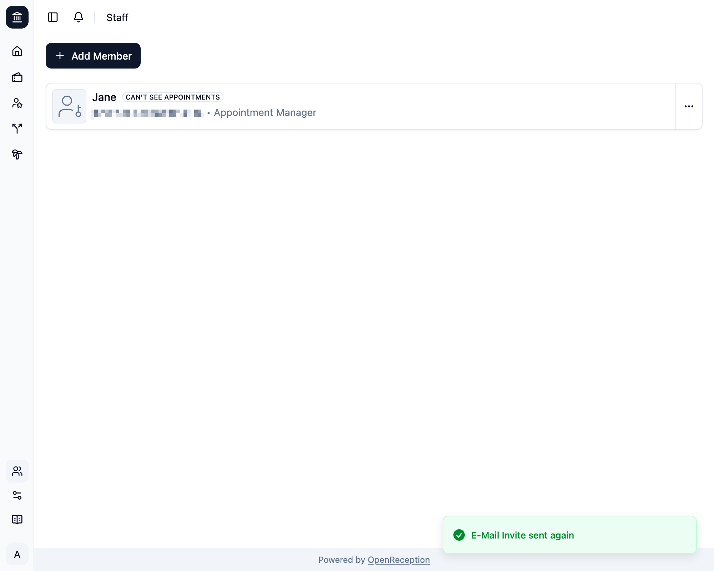

import {Steps} from "@astrojs/starlight/components";

Before you add a staff member, decide on the [role](/staff#roles) this staff member should get.

:::note
In this section you cannot add Global Admin users.
:::

<Steps>

1. Navigate to the staff member section of the dashboard and click on _Add Member_

   

1. A modal with a form opens.
   - Add a **name**
   - Add an **e-mail address**.
   - Change the **language**, if you want.
   - Set the **role** for this account.

   

1. Then click _Add Member_ and it will be saved.
   

1. They will get an e-mail with an expiring confirmation code. They can re-issue an updated one, if they are not quick enough.

</Steps>

## Finalize Staff Member Onboarding

If you already have appointments in your instance, you have to grant this new staff member access to those. Follow this process, to make it work:

<Steps>

1. The [new staff member must setup their account](/account/setup-account).

1. You, or any other fully onboarded staff member, must [grant access](/staff/grant-access-to-staff-member) to them.

</Steps>

## Send Invite again

If the staff member cannot find the invitation e-mail, you can resend it.

<Steps>

1. Navigate to the staff member section of the dashboard, search for the member you want to resend the invite to and open the context menu for it. Click on _Resend Invite_.

   

1. A modal will open asking you to confirm that you want to resend the invitation. Click _Resend Invite_ to proceed.

   

1. The staff member will receive a new invitation e-mail with an updated confirmation code.

   

</Steps>
